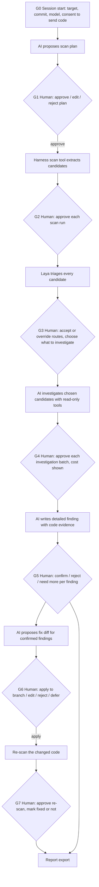

# Architecture modification: human-gated AI harness

Status: phases 1–5 implemented in `src/vulnscan/harness/` and `devsec chat`
(console). Not implemented: phase 6 (Go chat TUI, dashboard session pages),
streaming, prompt caching, `/compact`, `check_dependency` (open question Q2) and
the experiment of section 8. Written 2026-11-01 against agent 0.3.0 (commit
`f7d4fc7`) and essay `essay/DeCuongChiTiet_v6_HinhMoi.docx`; implemented the same
day on branch `feat/human-gated-harness`, and section 13 is the change record.
Supersedes `docs/HARNESS-TUI-PLAN.md` where the two disagree (section 9).

## 1. What changes

Version 0.3.0 is a fixed scanner pipeline. `ScanService` runs Semgrep,
Gitleaks, SpotBugs/FindSecBugs and Dependency-Check in a fixed order. Laya is
optional and off by default, and the LLM agent is never called
(`targeted_deep_analysis` always reports "Deep analysis is not implemented").

The target system is a **hand-written, human-gated harness**. Detection comes
from the harness's own static tools: source–sink rules and route lookup in
`harness/scanning.py`. **The AI is a supporting tool, not the detector** (D10).
It investigates the candidates those tools found, explains them, proposes
CVSS vectors and fixes. Laya narrows the work, and a human decides.

```
Human ⇄ Harness (hand-written session loop, permission gates, audit log)
            │  provider layer: profile → protocol → transport, tool calling
            ▼
        Any model: Anthropic, OpenAI, OpenRouter, DeepSeek, Ollama, LM Studio, custom
        (switched with /model)
            │  tool calls, each checked by the harness
            ▼
        Harness tools: scan code → Laya triage → investigate → report → propose fix
            │
            ▼
        Human decides at every scanning step (no step runs on its own)
```

Third-party scanners (GitHub CodeQL, Semgrep, SpotBugs/FindSecBugs,
Dependency-Check, Gitleaks, SonarQube) are **not** part of this pipeline. They
are baselines, run separately, and their results are compared against the
harness in the experiment (section 8).

## 2. Decisions

| # | Decision |
|---|---|
| D1 | The harness (session loop, tool registry, gates, audit log) is written by the team. No agent framework (LangChain, AutoGen, etc.). |
| D2 | The model is not fixed. A provider layer (section 4.1, the Hermes pattern from `HARNESS-TUI-PLAN.md`) supports native Anthropic and any OpenAI-compatible endpoint: OpenAI, OpenRouter, DeepSeek, Ollama, LM Studio, custom. `/model` switches provider and model during a session. Every turn records provider, model id, tokens and cost. |
| D3 | The harness scans code with its own tools (section 5). Existing scanners are baselines only. |
| D4 | Laya runs inside the loop, before the LLM, to decide which candidates need deep reasoning and which kind. Its purpose is to reduce LLM tokens and time. It is on by default. |
| D5 | Two gate modes. `ask` (default): every gate waits for a human. `auto`: routine scanning gates (G1–G4, G7) are approved automatically and logged as person `auto`; **dangerous gates still wait for a human in every mode**: G0 (code leaves the machine, cost) and G6 (writing code). Nothing is approved by timeout or by a closed prompt. |
| D6 | Only a human sets a finding's final status (confirmed / rejected / needs more evidence). The AI and the validator only propose and check. In `auto` mode G5 does not block: the finding stays `proposed` and the human settles it later with `/review`. |
| D7 | The AI may propose code fixes as diffs. A fix is written only after a human approves it, only to a separate git branch, and is never committed, pushed or merged by the harness. |
| D10 | AI is a supporting tool (owner, 2026-11-02, following `special_requirements.txt`). The object of study is vulnerabilities in Java Servlet/JSP source code. The harness's static tools find candidates. The model may only investigate candidates in a batch opened at G3/G4, and `propose_finding` refuses anything else (`harness/tools.py`). The model never originates or decides a finding. Docs, the essay and the UI describe the model as "AI hỗ trợ" (AI support), never as the scanner or the core. |
| D8 | With a cloud provider, code excerpts leave the machine. The user must consent at session start and again after `/model` switches to a different provider; local providers (Ollama, LM Studio) need no consent. The report states which provider and model saw which files. |
| D9 | Chat is the main screen, as in `HARNESS-TUI-PLAN.md` §3: the user types a request, the answer streams, tool calls appear as blocks, permission dialogs pause the loop, the status line shows model, tokens and cost. Old views move behind `/scan`, `/history`, `/findings`, `/keys`. |

## 3. Pipeline and human gates



| Gate | What the human sees | Options | Recorded |
|---|---|---|---|
| G0 | Target path, commit, provider, model, budget, which data leaves the machine (repeated after `/model` changes provider) | start / cancel | consent, provider, model id, budget |
| G1 | AI's plan: modules, file globs, vulnerability classes, estimated tokens and cost | approve / edit / reject | plan before and after edit |
| G2 | Each scan tool call with its arguments (paths, rules) | approve / edit / reject | call, decision |
| G3 | Laya table: candidate, route, confidence, needs-review flag | accept / change route / exclude; select candidates | every override with reason |
| G4 | Batch of candidates the AI wants to read deeply, token and cost estimate | approve / shrink / reject | batch, decision |
| G5 | Finding card (section 6) | confirm / reject / need more evidence, with reason | final status, decider, time |
| G6 | Diff, affected files, risk notes, test the AI suggests | apply to branch / edit / reject / defer | diff hash, decision |
| G7 | Re-scan request on the fix branch | approve / reject; then mark fixed / not fixed | re-scan result, decision |

Gate behaviour by mode:

| Gate | `ask` | `auto` |
|---|---|---|
| G0 session, consent | human | **human** (dangerous) |
| G1 plan, G2 scan, G3 triage, G4 investigate | human | approved, logged as `auto` |
| G5 finding status | human | deferred: finding stays `proposed` until `/review` |
| G6 apply fix | human | **human** (dangerous) |
| G7 re-scan | human | approved, logged as `auto` |

The mode is chosen at session start (`--mode ask|auto`) or with `/mode`.
Switching to `auto` is itself logged.

Gate rules:

- A rejected step is not retried by the AI without a new human message.
- Waiting has no timeout that approves. A closed session leaves the step undecided.
- Read-only reads (`read_file`, `grep`) inside an **approved** G4 batch run
  without a prompt each, so the human approves the batch, not every line read.
  Each read is still logged and shown.
- CI or non-interactive runs cannot pass a scanning gate. They may only replay
  a recorded session for testing.
- Each decision is stored: gate, AI recommendation, human choice, reason,
  person, timestamp. The report includes this log.

## 4. Components

| Component | Responsibility | Starts from |
|---|---|---|
| Session loop | Message history, tool-call cycle, streaming, cancel, budget, max rounds | `agent/loop.py` (rewrite: session-level, not one finding) |
| Provider layer | Profiles, two transports, shared message format, `/model` (section 4.1) | `providers/client.py`, `contracts/provider.py`, `providers/budget.py`, `providers/credentials.py` |
| Tool registry | Tool schemas, argument validation, gate level per tool | `agent/tools.py` (today only schemas, no handlers) |
| Gate manager | Pauses the loop, sends a permission request to the UI, waits for the decision, logs it | new |
| Code scan tools | File inventory, route/filter index, source–sink candidate extraction, JSP expression map | `context/source_index.py`, `context/jsp_mapping.py`, `core/scan_service.py` intake |
| Laya triage | Route and priority per candidate, before the LLM reads anything | `decisions/` |
| Evidence checker | Checks every AI citation (file, line, snippet) exists; checks CVSS vector syntax and computes the score | `assessment/validator.py`, `assessment/cvss.py` |
| Report | Detailed finding cards, decision log, export to Markdown/HTML/SARIF/JSON | `reporting/` |
| Fix tools | Propose diff; apply approved diff in a git worktree branch | new |
| Audit store | Sessions, tool calls, gate decisions, tokens, cost (SQLite + JSONL) | `storage/` |
| UI | Chat TUI with permission dialogs; dashboard read-only | `internal/tui`, `internal/bridge`, `web/` |

### 4.1 Provider layer (Hermes pattern)

Each provider is declared once as a profile, and calls are routed by protocol
to a transport. The existing `ProviderProfile` (`protocol`, `base_url`,
`api_key_env`, `models`, `default_model`, `timeout_seconds`, `max_retries`,
`headers`) and `ProviderProtocol` enum already fit this.

| Profile | Protocol | Key | Runs |
|---|---|---|---|
| `anthropic` | `anthropic_messages` | `ANTHROPIC_API_KEY` | cloud |
| `openai` | `openai_chat_completions` | `OPENAI_API_KEY` | cloud |
| `openrouter` | `openai_compatible` | `OPENROUTER_API_KEY` | cloud |
| `deepseek` | `openai_compatible` | `DEEPSEEK_API_KEY` | cloud |
| `ollama` | `openai_compatible` | none | local |
| `lmstudio` | `openai_compatible` | none | local |
| `custom` | `openai_compatible` | user-supplied `base_url` and variable name | either |

Profiles are JSON files under `.providers/`; keys are referenced by
environment variable name only and entered through the existing `/keys` view.

Transports, one interface `stream(messages, tools) → events`:

- `AnthropicTransport`: Messages API, SSE streaming, `tool_use` and
  `tool_result` blocks, prompt caching on the system prompt and tool definitions.
- `ChatCompletionsTransport`: extends `providers/client.py` with `stream=true`
  and assembles streamed tool-call fragments into whole calls.

One internal message format is converted to each provider's format at the
transport edge, so sessions, gates, telemetry and the TUI never depend on the
provider. `BudgetManager` limits, `redact` on everything sent out, a price
table per model, and retries with backoff apply to every provider.

Commands: `/model` (switch provider and model; triggers G0 consent when the
new provider is a cloud one), `/cost`, `/resume`, `/clear`, `/compact`,
`/export`, `/help`. Not taken from Hermes: OAuth logins, provider plugins,
key rotation.

Events harness → TUI: `text_delta`, `tool_call`, `tool_result`,
`permission_request`, `usage`, `error`, `done`. Messages TUI → harness:
`user_message`, `permission_reply`, `interrupt`, `command`.

## 5. Tools

| Tool | Gate | Purpose |
|---|---|---|
| `propose_scan_plan(scope, classes)` | G1 | AI states what it intends to scan |
| `inventory(globs)` | G2 | List Java/JSP/config files in scope with hashes |
| `extract_candidates(classes, paths)` | G2 | Hand-written source–sink pass: request parameters, JDBC calls, `Runtime.exec`, file paths, redirects, XML parsers, deserialisation, crypto and random APIs, servlet routes without auth checks |
| `laya_triage(candidate_ids)` | G2 | Laya routes each candidate |
| `read_file(path, lines)`, `grep(pattern, glob)` | inside an approved G4 batch | Target checkout only, size-capped |
| `lookup_route(class_or_url)` | inside G4 | Servlet route, filters, auth checks on the path |
| `check_dependency(group, artifact, version)` | G2 | Look up known CVEs for a `pom.xml` dependency (see open question Q2) |
| `propose_finding(...)` | G5 | Records a proposal; never sets status |
| `propose_fix(finding_id, diff, test)` | G6 | Records a diff; writes nothing |
| `apply_fix(finding_id)` | G6 (human only) | Applies the approved diff on branch `devsec/fix-<finding_id>` in a worktree |
| `rescan(paths)` | G7 | Runs the candidate extraction and investigation again on the fix branch |

No tool runs arbitrary shell commands, reaches the network except the model
API (and the CVE lookup if Q2 is accepted), or writes outside the fix worktree.

### Laya's role

Laya receives each candidate and returns a route (`authorization_analysis`,
`cross_file_analysis`, `jsp_context_analysis`, `fast_verification`,
`dependency_analysis`, `secret_review`, `human_review`, `low_priority`) and
confidence. The harness then:

- gives the LLM only the tools and the prompt section for that route;
- does not send `low_priority` candidates to the LLM unless the human picks them at G3;
- sends `human_review` candidates straight to the human with the code excerpt.

Two changes are required before this works:

1. **Input format.** Laya's state today is built from scanner fields (scanner,
   rule id). Without scanners in the pipeline, the state must come from the
   candidate: sink API, source kind, route, auth-check presence, file type.
2. **Quality and speed.** On the 2026-11-01 baseline scan, 365 of 415 findings
   fell to `human_review` because the top confidence was low, and the
   checkpoint warned that some confidence values are uncalibrated. The
   checkpoint must be fine-tuned on reviewed labels (`docs/LAYA-TRAINING.md`)
   before Laya saves real effort. The same run took 36.6 min for 415 findings
   on the CPU and timed out with the shipped `timeout_seconds: 30`; use 300 s.
   The CPU is deliberate (`decisions/model_worker.py:32-35`: the 4 GB GTX 1650
   runs out of memory), so speed comes from fewer, better candidates, not the GPU.

## 6. Finding card in the report

Each finding shows:

- title, CWE, OWASP Top 10:2025 category
- source → sink path: each hop as `file:line` with the code excerpt
- the route checked (servlet URL, filters, auth checks found or missing)
- AI explanation, and what evidence would change the conclusion
- CVSS v4.0 vector proposed by the AI, score computed by `assessment/cvss.py`, assumptions listed
- Laya route and confidence
- evidence check result (every citation exists or the card is marked)
- human decision, reason, person and time
- fix: proposed diff, decision, branch, re-scan result
- model, provider, tokens and cost spent on this finding

## 7. Code changes

| Area | Change |
|---|---|
| `agent/loop.py` | Session loop over many tool calls; gate pauses; route-specific prompts; budget per session and per finding |
| `agent/tools.py` | Implement handlers for every tool in section 5; add gate level to each schema |
| `providers/` | Built-in profiles (section 4.1); `AnthropicTransport`; streaming and tool-call assembly in the Chat Completions transport; shared message format; price table |
| `context/` | Wire `source_index` and `jsp_mapping` into `extract_candidates` |
| `decisions/` | Candidate input (`triage_many_batched` takes a `to_state` function); harness runs Laya regardless of `enabled`, which keeps meaning "on in `scan-run`"; `timeout_seconds: 300` |
| `assessment/validator.py` | Becomes the evidence checker; no longer sets final status |
| `assessment/cvss.py` | Implement the CVSS v4.0 equivalence-class scoring (current formula does not follow the specification) |
| `contracts/` | `FindingStatus` owner = human; new `GateDecision`, `FixProposal` contracts |
| `core/scan_service.py` | Stays as the **baseline runner** for section 8; no longer the main entry point |
| `internal/tui`, `internal/bridge` | Chat view, permission dialog without "always", diff viewer |
| `web/` | Session pages: transcript, gate log, finding cards, fixes |
| `storage/` | Tables for sessions, tool calls, gate decisions, fixes |
| New `fix/` | Worktree management, diff apply, re-scan trigger |
| `config/laya.json` | `timeout_seconds` 30 → 300 |
| `pipeline/runner.py:231`, `decisions/model_worker.py:35` | Both pin `device="cpu"` on purpose (4 GB GPU runs out of memory); `LayaConfig.device` is ignored. Leave the CPU default; no change in this plan |
| `providers/client.py` | Drops `tool_calls` and `tool_call_id` when it re-sends history, so multi-turn tool calling cannot work. The harness uses its own transports |
| `cli/main.py` `main()` | Forwards every command except `tui` and `scan-run` to the Go binary when it exists; `chat` must stay in Python |

## 8. Experiment: harness against baselines

Same target (JVA-bookstore at `dd48d12`), same labelled ground truth.

| Config | What runs |
|---|---|
| B1 | Semgrep (project rules) |
| B2 | SpotBugs + FindSecBugs |
| B3 | GitHub CodeQL, `security-extended` Java queries (SARIF imported) |
| B4 | OWASP Dependency-Check (dependency findings only) |
| B5 | Gitleaks (secrets only) |
| B6 | The same model as S1/S2, one prompt per file, no tools |
| B7 | `scan-run` model paths without harness gates: `--mode hunt`, `--ai-review`, `--ai-report`; cloud providers need `--allow-cloud-model` |
| S1 | Harness without Laya |
| S2 | Harness with Laya |
| S3 | S2 repeated on other provider profiles (for example one Anthropic, one OpenAI-compatible cloud, one local model) |

B1, B2, B4 and B5 can reuse today's `scan-run --profile full --no-laya`; the
run on 2026-11-01 (`evidence/jva-fullscan-2026-11-01/run-4c67cbbd…`) is a
baseline result. B3 needs the CodeQL adapter finished or CodeQL run through
GitHub code scanning with the SARIF imported.

Metrics: precision, recall, F1, FPR per CWE class; CVSS vector and score error;
tokens, cost and time per finding; Laya effect (S2 against S1: tokens, time,
recall lost); number of human decisions and minutes per gate; fixes proposed,
approved, and verified by re-scan; provider comparison (S3) on the same metrics.

## 9. Differences from `docs/HARNESS-TUI-PLAN.md`

| Plan said | Now |
|---|---|
| Permission dialog `[y] yes [a] always [n] no`, mode `auto-scan` | No "always" per tool; modes `ask` and `auto`, and `auto` never passes G0, G5 or G6 |
| `run_scan(profile)` tool runs the existing scanners | Scanners are baselines; the harness has its own scan tools |
| Validator decides status | Human decides; validator checks evidence |
| Edit tools and fix mode "later" | Fix proposal and human-approved apply are in scope |
| Laya not mentioned in the loop | Laya triages before the LLM |
| Provider layer, chat screen, slash commands, telemetry | Kept unchanged (sections 4.1 and D9) |

## 10. Essay corrections (`DeCuongChiTiet_v6_HinhMoi.docx`)

The essay describes 0.3.0: deterministic scanners detect, AI only supports,
fixing forbidden, the validator decides. Every section below conflicts with
the target architecture.

| Section | Now says | Change to |
|---|---|---|
| Mở đầu §2 Mục tiêu | "Agentic AI chỉ hỗ trợ phân tích ngữ cảnh"; goal 5 compares the system with each tool used alone | Keep "AI chỉ hỗ trợ" (AI only assists; D10). Static analysis by the harness's own tools detects candidates; AI supports investigation, explanation, CVSS vectors and fixes; a human decides at every step. Keep the comparison goal, with the tools as baselines |
| §3 Câu hỏi và giả thuyết | Q1 and H1: "thêm lớp hỗ trợ Agentic AI sau chuỗi công cụ tất định" | Q1: harness (S1/S2) against baseline tools. New: how much does Laya reduce tokens and time, and at what recall cost? How many human decisions does one scan need? How many proposed fixes are accepted and pass re-scan? |
| §4 Đối tượng và phạm vi | "hệ thống chỉ dùng phân tích tĩnh, gồm bốn công cụ" | The system uses its own static analysis tools driven by the LLM; the four tools and CodeQL are baselines. The model is chosen per session from several providers. The survey criterion "không gửi mã nguồn ra ngoài" holds only with a local model; with a cloud provider, state that excerpts leave the machine with user consent |
| §5 Giới hạn | "Một phần thành phần AI chưa nối vào luồng quét" | Replace with the real limits of the new design: cloud model, Laya quality before fine-tuning, human time cost, one target app |
| §6 Mức độ sử dụng AI | "quyền quyết định thuộc về luật cố định"; "AI không ... sửa mã"; validator accepts or rejects | Human holds the decision; AI proposes findings and fixes; fixes go to a separate branch only after approval |
| 1.4.6 and Hình 1.5, 1.6 | Five steps: quét → phân loại → chấm điểm → kiểm chứng → báo cáo | Seven steps with gates: plan → scan → Laya triage → investigate → report → fix decision → re-scan; three output states decided by a human |
| 1.5 (opening) | "việc phát hiện do bốn công cụ phân tích tĩnh đảm nhận" | Detection by harness tools plus LLM reasoning, with Laya to narrow the work |
| 1.5.3 Bảng 1.9 | Level 3 (sửa mã) "Không cho phép"; Laya "mặc định tắt" | Add a level between 2 and 3: "đề xuất bản vá, người duyệt áp dụng trên nhánh riêng" (chosen); level 3 (AI applies or merges itself) stays forbidden; Laya on |
| 1.5.4 Bảng 1.10 | Validator with fixed rules decides; "tác tử chỉ đọc, không ghi tệp"; lists tool locations in `agent/tools.py` | Human decides; validator checks citations. Writing allowed only for approved fixes in the worktree. Note: in 0.3.0 `agent/tools.py` holds only schemas; the essay must not present those tools as working |
| 2.1–2.6 Khảo sát | Survey of tools as candidates for the system | Keep, reframed as selecting baselines; add GitHub CodeQL as B3 |
| 2.7 Yêu cầu, Bảng 2.3 | K4: "không chấp nhận đánh giá AI nào chưa qua kiểm chứng máy móc" | Add requirements for gates G0–G7, decision log, fix proposal and apply, Laya triage, model consent |
| 2.8.1, Hình 2.4, 2.5 | Five interfaces call `ScanService`; eight fixed stages | Harness architecture (section 1 diagram) and gate sequence (section 3) |
| 2.8.3 | Scanners run inside the system | Move to Chương 3 as baseline configuration |
| 2.8.4, Hình 2.6, 2.7 | Two AI layers; Laya optional after scanners; agent "chưa nối" | Laya is a tool the AI calls before deep reasoning; route decides the prompt and tools |
| 2.8.7, Hình 2.10 | Validator decision tree sets status | Validator checks evidence; human sets status |
| New 2.8.x | — | Fix proposal and approval; report finding card (section 6) |
| 3.5.3 | Generic OpenAI-compatible API; Laya "giới hạn 30 giây mỗi lô" | Provider layer with profiles and two transports; list the providers and exact model ids used in the experiment, temperature, prices; Laya 300 s (30 s made every batch time out on 2026-11-01) |
| 3.5.4 Nhóm đối chứng | Single tools and model without agent | B1–B6 in section 8 |
| 3.8.1 | Steps as recorded by `ScanService` | Session steps with gates; record every decision |
| 3.8.5 Kết quả chạy thử | Earlier runs | Add the 2026-11-01 baseline run: 415 findings (57 high, 358 medium), Laya 365 `human_review` / 49 `low_priority` / 1 `authorization_analysis`, on CPU |
| 3.9 Chỉ số | Precision, recall, F1, FPR, CVSS error, time, cost | Add Laya token reduction, human decisions and minutes per gate, fix acceptance and re-scan pass rate, comparison across providers |
| Chương 4 | Results of the pipeline | Add sections for Laya effect, human workload and fixes; 4.4 compares with B1–B6 |
| Kết luận, Hạn chế, Định hướng | Based on 0.3.0 | Rewrite after the new results exist |
| Figures | 1.5, 1.6, 2.4, 2.5, 2.6, 2.7, 2.10, 3.3 | Redraw in `essay/figures/build_figures.py`; add harness architecture and gate sequence figures |

## 11. Open questions

| # | Question | Default if not answered |
|---|---|---|
| Q1 | Must each `read_file` inside an approved batch also be approved? | No: approve the batch, log every read |
| Q2 | Dependency CVEs without Dependency-Check: query OSV (osv.dev) from `check_dependency`, or leave dependencies to baselines? | OSV query, approved at G2 |
| Q3 | Which providers and models go into the experiment (S1–S3)? | One Anthropic model, DeepSeek as the OpenAI-compatible cloud model, one local Ollama model; exact ids and prices recorded on the run date |
| Q4 | Who labels the ground truth for B1–S2? | Two reviewers, as in essay §3.7 |
| Q5 | Should cloud providers be blocked entirely for some targets (code that must not leave the machine)? | A per-target `local_only` flag that hides cloud profiles from `/model` |

## 12. Phases

| # | Delivers | Done when | State on 2026-11-01 |
|---|---|---|---|
| 1 | Provider layer (both transports, built-in profiles, `/model`), session loop, gate manager, audit store | The same 3-turn tool-calling session passes on Anthropic and on an OpenAI-compatible provider, against recorded replies in CI and once live; every gate decision is in the log | **Done except the live call.** `harness/providers.py`, `messages.py`, `session.py`, `gates.py`, `audit.py`; both transports tested against recorded HTTP replies; no live provider call was made (no key and no local model on the build machine). |
| 2 | Scan tools (`inventory`, `extract_candidates`, `lookup_route`, `read_file`, `grep`) | Candidates for JVA-bookstore cover the 5 manual cases in `HARNESS-TUI-PLAN.md` §10 | **Done.** 612 candidates on JVA-bookstore at `dd48d12`; the five manual cases are candidates, tested. |
| 3 | Laya on candidates (new input format, 300 s) | Laya routes every candidate; G3 override works | **Done.** `harness/triage.py` with `candidate_state`; `triage_many_batched(..., to_state=)`; `config/laya.json` timeout 300. Without the optional `laya` package every candidate falls back to `human_review` (tested). |
| 4 | Finding cards, evidence checker, CVSS v4.0 scoring | Every card's citations verified; vector scores match the FIRST calculator | **Done.** `harness/evidence.py`, `harness/report.py`; the score comes from `cvss` 3.6, never from a model or a person. |
| 5 | Fix proposal, worktree apply, re-scan | One confirmed finding fixed on a branch and re-scanned, all through gates | **Done in code and tests.** `harness/fixes.py` plus the `propose_fix` and `rescan` tools, exercised on a throwaway git fixture, not on JVA-bookstore. |
| 6 | Chat TUI (streaming, tool-call blocks, permission dialog, status line, slash commands) and dashboard session pages | A full session runs from the TUI; after a restart `/resume` continues it with costs intact | **Console only.** `devsec chat` runs sessions with text prompts and slash commands. Streaming, the Go TUI dialogs and the dashboard pages are **not implemented**; `/resume` loads history, not worktrees. |
| 7 | Experiment B1–S3 and essay update | Section 8 metrics filled; essay sections in section 10 rewritten | **Not implemented.** |

## 13. Implementation record (2026-11-01)

Branch `feat/human-gated-harness`, one commit per plan task. This section is the
record of what the code does today; the plan file is
`docs/superpowers/plans/2026-11-01-human-gated-harness.md`.

### 13.1 Files

New package `src/vulnscan/harness/`:

| File | Responsibility | Tests |
|---|---|---|
| `__init__.py` | package docstring | — |
| `messages.py` | `ToolCall`, `Message`, `Usage`, `Reply`, `ProviderError`, `Transport` | `test_providers.py` |
| `providers.py` | six built-in profiles, `PRICES`, `ChatCompletionsTransport`, `AnthropicTransport`, `make_transport`, `all_profiles`, `is_local`, `price` | `test_providers.py` (10) |
| `gates.py` | `Gate`, `CHOICES`, `GateRequest`, `GateDecision`, `DANGEROUS`, `HUMAN_STATUS`, `GateKeeper`, `refuse_all` | `test_gates.py` (10) |
| `audit.py` | `SessionLog` (append-only JSONL, resume, totals), `new_session_path` | `test_audit.py` (5) |
| `workspace.py` | `PathEscape`, `Candidate`, `Hop`, `ProposedFinding`, `FixProposal`, `Workspace` (path confinement, read, grep) | `test_workspace.py` (8) |
| `scanning.py` | `inventory`, `SinkRule`, 14 `SINK_RULES`, the `missing_role_check` route rule, `extract_candidates`, `lookup_route` | `test_scanning.py` (5) |
| `triage.py` | `candidate_state`, `triage_candidates` (Laya on candidates, never raises, never sets status) | `test_triage.py` (4) |
| `evidence.py` | `check_citations`, `score_cvss4` | `test_evidence.py` (7) |
| `fixes.py` | `FixError`, `apply_fix` (worktree branch), `rescan_fix` | `test_fixes.py` (4) |
| `tools.py` | `ToolContext`, `ToolSpec`, the 12 tools in 13.2, `schemas`, `run_tool` | `test_tools.py` (6) |
| `session.py` | `SYSTEM_PROMPT`, `Session` (G0, `send`, `switch`, rejected-call memory, budget, resume) | `test_session.py` (6) |
| `report.py` | `render_markdown` (finding cards, decision log, session totals), `export` (`report.md` + `report.json`) | `test_report.py` (1) |
| `console.py` | `console_asker` (keys, no default-yes), `ChatConsole` (`/help`, `/model`, `/mode`, `/cost`, `/review`, `/export`, `/resume`, `/clear`, `/quit`) | `test_console.py` (3) |

Modified:

| File | Change |
|---|---|
| `src/vulnscan/decisions/batching.py` | `triage_many_batched(..., to_state: Callable[[Any], dict[str, Any]] = finding_to_state)` |
| `config/laya.json` | `timeout_seconds` 30 → 300 |
| `pyproject.toml`, `uv.lock` | add `cvss==3.6` as a runtime dependency (pre-approved by the plan) |
| `src/vulnscan/cli/main.py` | new `chat` command; `main()` keeps `chat` on the Python surface |
| `.gitignore` | `.devsec/`; the bare `harness/` pattern anchored to `/harness/` so the new package and tests are trackable |
| `README.md`, `docs/BUILD-AND-RUN.md`, `docs/HARNESS-TUI-PLAN.md`, `CHANGELOG.md` | describe the harness as the main path and the scanners as baselines |
| `tests/harness/` | `__init__.py`, `fakes.py` (`BatchAgent`, `ScriptedTransport`), one test file per module |

### 13.2 Tools and gates as implemented

| Tool | Gate | Writes nothing | Notes |
|---|---|---|---|
| `propose_scan_plan` | G1 | yes | `edit` replaces `scope` and `classes`; a rejected plan blocks every scan tool |
| `inventory` | G2 | yes | needs `ws.plan`; returns path, kind, lines, sha256 |
| `extract_candidates` | G2 | yes | needs `ws.plan`; defaults from the plan |
| `laya_triage` | G2 | yes | runs Laya on the CPU; a failure sends every candidate to `human_review` |
| `select_candidates` | G3 | yes | `edit` replaces the chosen ids; sets `selected` |
| `begin_investigation` | G4 | yes | only G3-selected candidates with a recorded Laya route, including `human_review`; validates edited ids too; opens the batch and resets its token counter |
| `read_file`, `grep`, `lookup_route` | — | yes | require an open batch; output is wrapped in `<untrusted_code>` |
| `propose_finding` | G5 | yes | checks citations, scores the vector, records the human's status |
| `propose_fix` | G6 | until apply | requires a `confirmed` finding; apply writes only in the worktree |
| `rescan` | G7 | yes | requires an applied fix; checks the original candidate file and changed files; reports `candidate gone` or `still present` |

There is no `apply_fix`, `shell`, `exec`, `write_file` or `run_command` tool.

### 13.3 Verification run

This table records the initial implementation run, before the review fixes
described in section 13.6.

| Command | Result |
|---|---|
| `.venv\Scripts\python.exe -m ruff check src tests` | All checks passed |
| `.venv\Scripts\python.exe -m ruff format --check src tests` | 205 files already formatted |
| `.venv\Scripts\python.exe -m mypy src/vulnscan` | Success: no issues found in 122 source files |
| `.venv\Scripts\python.exe -m pytest -q` | 486 passed, 1 skipped in 94 s |

The skip is `test_resolve_rejects_symlink_out` (Windows without developer mode).
The harness suite alone is 69 tests. `extract_candidates` on JVA-bookstore at
`dd48d12` returns 612 candidates: CWE-79 541, CWE-862 25, CWE-200 18, CWE-798 10,
CWE-89 6, CWE-601 4, CWE-22 3, CWE-306 3, CWE-330 2.

### 13.4 Deviations from this spec and from the plan

1. **Evidence checker and fix worktrees live in `harness/`**, not in
   `assessment/validator.py`, `assessment/cvss.py` and a new `fix/` package as
   section 7 says. The plan file names `harness/evidence.py` and
   `harness/fixes.py`; the plan wins for the implementation, the spec's module
   list is stale on these two points.
2. **No storage tables.** Section 4 lists SQLite tables for sessions, tool calls,
   gate decisions and fixes. The plan replaces them with the append-only JSONL
   session log (`harness/audit.py`) and the in-memory `Workspace`; the report
   exports JSON. SQLite stays for `scan-run` only.
3. **`assessment/cvss.py` is untouched.** CVSS v4.0 scoring is
   `harness/evidence.py:score_cvss4` using the `cvss` package. The old formula in
   `assessment/` is still used by the baseline pipeline and was not changed.
4. **`assessment/validator.py` still exists and still decides for `scan-run`.**
   The harness never calls it; its own `check_citations` is the evidence check.
   Removing the validator's status authority from the baseline pipeline is not
   part of this change.
5. **The plan's `= []` and `= {}` dataclass defaults** became
   `field(default_factory=...)`; `dataclasses` rejects mutable defaults.
6. **`.gitignore` had a bare `harness/`** that matched `src/vulnscan/harness/`
   and `tests/harness/`; it is now `/harness/`. Without this the new package
   cannot be committed.
7. **`_is_literal_call` anchors on the regex match end**, not on the next `(`
   after the match start; the latter misreads `r.getWriter().write("ok")` as
   non-literal and produces a false candidate.
8. **Candidate extraction builds the source index once per call**, not per file.
9. **`import cvss` carries `# type: ignore[import-untyped]`**; the package ships
   no `py.typed` and mypy runs in strict mode.
10. **`GateKeeper` treats any asker exception as `undecided`**, not only
    `EOFError`/`KeyboardInterrupt`. This follows `AGENTS.md` H5 (an exception is
    never approval); the reason string records the failure.
11. **`/resume` loads the message history only.** Findings, candidates and fixes
    are not rebuilt by replaying tool calls; `console.py` marks this with a
    `ponytail:` comment.
12. **`PRICES` is empty**, so `cost_usd` is `0.0` until real prices are recorded.
    The budget still counts spend as zero; that is a known limit, not a bug.
13. **No live provider call was made.** Task 12 step 5 of the plan (a manual
    `devsec chat` run against DeepSeek) was not executed: this machine has no
    cloud key configured and nothing listens on `127.0.0.1:11434` (Ollama). The
    transport path is covered by recorded HTTP replies only.

### 13.5 Not implemented

Phase 6 and 7 of section 12; plus, from the plan's "not in this plan" table:
the Go chat view and permission dialog, SSE streaming and Anthropic prompt
caching, `/compact`, `check_dependency` with OSV, Laya fine-tuning, the
B1–S6/S1–S3 experiment and the essay rewrite.

### 13.6 Review corrections

- `Workspace.files` validates every enumerated path through `Workspace.resolve`
  before reading it. Inventory, grep, extraction and route indexing share this
  enumeration. The shared source index accepts the harness's confined file list.
- Direct and enumerated reads exclude `.env`, `.env.*` and `.secrets`, including
  aliases resolving to them. `.env.example` is allowed. Parent path components
  and Windows drive-relative paths are rejected.
- Normal provider request and response bodies, tool results, console output,
  JSONL events and Markdown/JSON reports pass through `credentials.redact`.
  Redaction does not alter the in-memory diff used by git.
- The console displays request payloads and the complete fix diff before
  accepting G6. Malformed or non-object JSON edits leave the gate undecided.
  These corrections enforce the existing gate rules; gate authority is unchanged.
- Investigation batches require a recorded Laya outcome for every selected id,
  including human-edited ids. An unavailable Laya outcome routes to `human_review`.
- Fix worktree paths become absolute relative to the caller before invoking git
  and use the same resolution for re-scans. Verification includes the original
  candidate file, so changes confined to an unrelated file cannot remove it.
- Route lookup includes filters applicable to the servlet URL using exact,
  path-prefix and extension mappings. Authorization checks in those filter
  files contribute to `auth_check`. This is static evidence, not proof that
  the guard is effective at runtime.
- All shipped dependency exports include the required `cvss==3.6` from `uv.lock`.

Requirements trace: SRS FR-16 (route/filter mapping), QR-01/QR-04 (honest
verification), QR-12 (secrets), QR-20 (platform support), and AGENTS A5, H5,
S2, T5, K1–K3.

### 13.7 Review-fix verification (2026-11-01)

| Check | Result |
|---|---|
| Ruff check `src tests` | All checks passed |
| Ruff format check `src tests` | 206 files already formatted |
| Strict mypy `src/vulnscan` | No issues in 122 source files |
| Harness tests | 113 passed |
| Full pytest suite | 530 passed, 1 skipped, 2 warnings |

The skip is `tests/analysis/test_adapter_unavailable.py`: the Semgrep binary
is installed, so its unavailable-binary case does not apply. The warnings
concern Starlette's httpx deprecation and terminal echo control in an existing
empty-key test. Provider tests used mock HTTP replies; live-provider smoke
testing was skipped. The unimplemented features remain listed in section 13.5.

The first sandbox full-suite run produced 32 scanner setup errors because
Semgrep exited with `ca_certs_iter_on_anchors: CertOpenSystemStore returned NULL`.
Host access resolved that error. A host run using a temporary directory inside
the checkout then failed two root-discovery tests because they found the parent
repository. The final passing run used host access and a fresh temporary
directory outside the checkout, with a separate pytest cache. No tests were
disabled to obtain the passing run.

### 13.8 CI alignment

Required checks now include a dedicated mocked harness suite on Linux, Windows
and macOS. All offline Python test areas still run on Linux Python 3.11–3.13
and Windows/macOS Python 3.11. Native jobs run Go vet/tests, build the binary,
then run the platform, CLI and Python TUI suites. JUnit and Python coverage
artifacts are retained when tests fail.

The quality job checks the three shipped requirements exports against `uv.lock`
and lints `ci/` alongside application code and tests. CI syncs with `--locked`
and then uses `uv run --no-sync` to preserve the requested extras. The wheel,
Action and scanner-image installations check packaged assets, CVSS and both
chat aliases; unattended G0 and G6 stay refused. No provider keys are supplied
and model downloads are disabled. These are scripted checks, not a live model run.

The `CI required` aggregate job fails for any failed, skipped or cancelled
prerequisite. Full baseline integration remains scheduled/manual and a release
prerequisite. Release jobs select Python explicitly and continue using the
frozen commit and the package job's distribution artifact. Publishing still
requires maintainer dispatch. See `docs/CI-INTEGRATION.md` for the workflow map.

Package smoke selects the exact current-version wheel and source archive,
preserving older local builds. Official Action revisions are refreshed to
reviewed stable releases and pinned by full SHA throughout the delivery paths.

### 13.9 Merge with main and stabilization (2026-11-02)

`origin/main` (`8d9eeb4c13793375699bbb7226c14a0fc56b06f6`, 41 commits) was merged
into `feat/human-gated-harness` with `--no-ff`; the merge commit is `b19b84e`.
Two files conflicted. `pyproject.toml` keeps both `cvss==3.6` (this branch) and
`python-docx>=1.1.0` (main), with `sse-starlette` merged automatically; `uv.lock`
and the three requirement exports were regenerated and `ci/check_lock_exports.py`
reports a match for each. `CHANGELOG.md` became one `Unreleased` section, branch
entries first.

The merge exposed two real incompatibilities, both fixed rather than papered
over:

- `base.html` now reads `request.url.path`, but the native dashboard renders
  through `core/rpc.py` `render_page` with a plain dict. `render_page` supplies a
  request stub and `internal/dashboard/server.go` passes `r.URL.Path`, so nav
  highlighting matches the Python dashboard.
- The Python `ScanService` always writes `final-report.md`, so native runs failed
  the parity test. `core/rpc.py` now generates the same artifact in its `reports`
  helper, and `internal/service/scan.go` records the aggregate `scanners` stage
  and the `final_report` stage, so native and Python stage histories match.

Stabilization changes in this section:

- **B7 consent.** `core/model_consent.py` decides whether a model may be used.
  Loopback base URLs (`localhost`, `127.0.0.1`, `::1`) are allowed because no
  code leaves the machine; anything else needs `allow_cloud_model`. `scan-run`
  exposes `--allow-cloud-model`, the web New Scan form carries the same checkbox
  (unticked by default), and `ScanService` checks consent once before any
  `ProviderClient` exists. A refusal is recorded on `model_hunt`,
  `targeted_deep_analysis` and `final_report` as `skipped` with the
  `--allow-cloud-model` reason; it is not raised as an error.
- **Redaction.** `providers.credentials` matches key *formats* and the literal
  values of loaded `*_API_KEY`/`*_TOKEN`/`*_SECRET` variables instead of a broad
  `sk|pk|tok|api` prefix. `redact_value`/`redact_json` replace
  `redact(json.dumps(...))` at every structured call site — both directions of
  the provider boundary, the session log, tool results and report exports — so
  model output, audit lines and reports stay valid JSON and code such as
  `token.isEmpty()` is preserved.
- **Web UI in CI.** A `web-ui` job (Node 24, committed lock file) runs `npm ci`,
  `npm run lint`, `npm test` and `npm run build`, and is part of the
  `CI required` needs list. `tests/platform/test_ci_contract.py` enforces it.

Verification actually run, in order: pre-merge `547 passed, 1 skipped`; after the
merge `649 passed, 1 skipped`; after B7 `662 passed, 1 skipped`; after redaction
`676 passed, 1 skipped`. `ruff check`, `ruff format --check` and strict `mypy`
(131 files) are clean. `go vet ./...` is clean and `go test ./cmd/... ./internal/...`
passes; `go test ./...` additionally collects the gitignored scratch probe in
`artifacts/tui-verification/`, which is injected with `-overlay` and is not
source. In `web-ui`: `npm ci`, `npm run lint`, `npm test` (17 files, 71 tests) and
`npm run build` pass. `ci/package_smoke.py` passes and still reports that an
installed `devsec chat` refuses G0 unattended.

Still not implemented: copying `web-ui/dist` into the wheel (a pip install serves
the JSON API and the Jinja pages, not the SPA); the shared test helpers and
`filter_match` export; the Go chat TUI, local triggers, web remote control and
the experiment harness in `docs/superpowers/plans/`.

