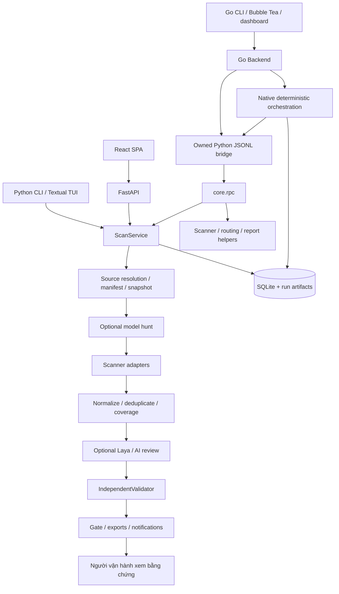

# Bản đồ mã nguồn DevSecOps-Agent

Tài liệu trả lời ba câu hỏi: **tệp nào làm gì, nằm ở đâu và chương trình chạy qua những bước nào**. Đối tượng đọc là người cần chạy dự án, lần theo một yêu cầu từ giao diện đến kết quả, hoặc tìm đúng nơi để sửa một chức năng.

Bản đồ được đối chiếu với working tree ngày 15/11/2026 trên nhánh `feat/native-workflow-notifications`, HEAD `03c5533`. Nhánh `my_tool_call` đã là tổ tiên của HEAD; phép kiểm tra `git merge-base --is-ancestor my_tool_call HEAD` trả mã 0. Working tree có nhiều thay đổi và tệp chưa được Git theo dõi, nên nội dung dưới đây mô tả mã hiện có trong checkout, không chỉ mã đã commit. Đặc biệt, `ci/launch.py` đang tồn tại nhưng chưa được Git theo dõi tại thời điểm đối chiếu.

Đây là tài liệu điều hướng mã, không phải kết quả chạy lại hệ thống hay chứng nhận mọi yêu cầu trong SRS đã được hoàn thành. Quy tắc làm việc nằm ở [AGENTS.md](../AGENTS.md); yêu cầu gốc nằm ở [SRS.md](SRS.md).

## 1. Đọc gì trước

| Muốn biết | Bắt đầu ở đâu | Đọc tiếp |
| --- | --- | --- |
| Cách cài và sử dụng | [README.md](../README.md) | [ci/launch.py](../ci/launch.py), [NATIVE-MIGRATION.md](NATIVE-MIGRATION.md) |
| Một lần quét thực sự chạy gì | [core/scan_service.py](../src/vulnscan/core/scan_service.py) | [core/config.py](../src/vulnscan/core/config.py), [pipeline/runner.py](../src/vulnscan/pipeline/runner.py) |
| Phát hiện đến từ đâu | [scanners/base.py](../src/vulnscan/scanners/base.py) | [native_hunt/engine.py](../src/vulnscan/native_hunt/engine.py), từng adapter trong [scanners/](../src/vulnscan/scanners/) |
| AI được phép làm gì | [agent/tools.py](../src/vulnscan/agent/tools.py) | [agent/loop.py](../src/vulnscan/agent/loop.py), [ai/review.py](../src/vulnscan/ai/review.py) |
| Ai quyết định trạng thái finding | [assessment/validator.py](../src/vulnscan/assessment/validator.py) | [VALIDATOR-CVSS.md](VALIDATOR-CVSS.md), luồng assessment trong [ai/review.py](../src/vulnscan/ai/review.py) |
| Dữ liệu lưu ở đâu | [storage/models.py](../src/vulnscan/storage/models.py) | [storage/database.py](../src/vulnscan/storage/database.py), thư mục đầu ra của từng run |
| Giao diện web gọi backend thế nào | [web-ui/src/api/client.ts](../web-ui/src/api/client.ts) | [web/phase2_routes.py](../src/vulnscan/web/phase2_routes.py), [web/app.py](../src/vulnscan/web/app.py) |
| Go còn cần Python ở bước nào | [internal/service/backend.go](../internal/service/backend.go) | [internal/service/scan.go](../internal/service/scan.go), [core/rpc.py](../src/vulnscan/core/rpc.py) |

## 2. Kiến trúc đang có

DevSecOps-Agent có nhiều giao diện nhưng dùng chung hợp đồng dữ liệu. Python giữ pipeline quét, adapter, bước AI, validator và bộ sinh báo cáo. Go có CLI, TUI, dashboard, truy vấn SQLite và một luồng điều phối deterministic riêng. Go vẫn sở hữu một tiến trình Python con để gọi các phần tương thích; khi bật Hunt, AI review hoặc AI report, nó chuyển việc thực thi sang Python `ScanService`.



Hai tên dễ nhầm:

| Tên | Mã ở đâu | Ý nghĩa |
| --- | --- | --- |
| `native-hunt` | [src/vulnscan/native_hunt/](../src/vulnscan/native_hunt/) | Bộ phân tích nguồn của dự án, viết bằng Python, dùng regex và truyền taint trong tệp. Không cần binary scanner ngoài. |
| Ứng dụng native Go | [cmd/](../cmd/), [internal/](../internal/) | CLI/TUI/dashboard và phần điều phối, lưu trữ, tính toán viết bằng Go. Binary thường nằm trong `bin/`. |

Tên “native” không có nghĩa bộ phân tích nguồn đã được viết lại hoàn toàn bằng Go. Mã `pipeline/runner.py` cung cấp helper và pipeline tái sử dụng; thứ tự toàn bộ luồng `scan-run` hiện tại phải đọc trong `ScanService._run`, vì luồng này còn có model hunt, so sánh và promotion.

## 3. Bản đồ thư mục gốc

| Đường dẫn | Trách nhiệm và lưu ý |
| --- | --- |
| [src/vulnscan/](../src/vulnscan/) | Package Python chính: hợp đồng, dịch vụ quét, scanner, AI, báo cáo và các giao diện Python. |
| [cmd/devsecops-agent/](../cmd/devsecops-agent/) | Điểm vào binary Go. |
| [internal/](../internal/) | Các package Go nội bộ: service, bridge, phân tích, TUI, dashboard và quản lý tiến trình. |
| [web-ui/](../web-ui/) | React SPA, cấu hình Vite, kiểu TypeScript và kiểm thử frontend. |
| [tests/](../tests/) | Test Python, fixture nguồn an toàn/dễ tổn thương, kiểm thử tích hợp và kiểm thử nền tảng. |
| [ci/](../ci/) | Launcher, build native, fixture scan, consumer Action và phát hành. |
| [config/](../config/) | Cấu hình được phân phối, gồm cấu hình Laya. Không đồng nhất với mọi giá trị mặc định trong dataclass runtime. |
| [docs/](./) | SRS, kế hoạch triển khai, hướng dẫn chức năng và bản ghi xác minh theo ngày. Bản ghi cũ không phải trạng thái kiểm thử hiện tại. |
| [scripts/](../scripts/) | Script so sánh baseline, lập bảng nhãn, benchmark Laya và ghi môi trường. |
| [notebooks/](../notebooks/) | Notebook phục vụ huấn luyện, thí nghiệm và phân tích. |
| [evidence/](../evidence/) | Bằng chứng, kết quả thí nghiệm và ảnh được giữ lại. Không ghi đè hay sửa kết quả lịch sử. |
| [essay/](../essay/) | Tài liệu Word tiếng Việt của chủ dự án. Tách khỏi chức năng export DOCX của ứng dụng. |
| [pyproject.toml](../pyproject.toml), [uv.lock](../uv.lock) | Metadata, console script, dependency và cấu hình Ruff/mypy/pytest; `uv.lock` khóa môi trường. |
| [go.mod](../go.mod), [go.sum](../go.sum) | Dependency Go và checksum module. `go.mod` khai báo Go 1.26.0; workflow native hiện chọn Go 1.27.1. |
| [action.yml](../action.yml) | Composite Action cho repository sử dụng công cụ để quét trong GitHub Actions. |
| [.github/workflows/](../.github/workflows/) | Check bắt buộc, tích hợp định kỳ/thủ công và release. |
| `.planning/`, `.hermes/` | Lịch sử lập kế hoạch và phiên làm việc; không thay thế trạng thái trong source và test. |
| `harness/` ở gốc | Cache clone mặc định của `--workdir`. Không phải chat harness G0–G7. |
| `.providers/` | Profile provider cục bộ. Profile dùng tên biến môi trường cho credential. |
| `.devsec/`, `.devsec-notifications.json` | Trạng thái/cấu hình cục bộ; không dùng chúng làm dữ liệu để đưa vào báo cáo công khai. |
| `.venv/`, `.venv-linux/`, `.tools/` | Môi trường và công cụ cục bộ. Không phải mã sản phẩm để commit. |
| `artifacts/`, `bin/`, `dist/`, cache test/build | Đầu ra được sinh khi chạy hoặc build. Có thư mục ở checkout không chứng minh binary hiện tại khớp source. |
| `vulnscan.db` và các tệp phụ SQLite | Dữ liệu runtime cục bộ. Tệp mặc định có thể được thay bằng `--db-path`. |

Các thư mục nội dung đích như `JVA-bookstore/` trong checkout là dự án được phân tích, không phải package của DevSecOps-Agent. Không sửa chúng để làm cho kết quả quét trông thành công.

## 4. Điểm vào và cách khởi chạy

### 4.1. Python CLI và cơ chế chọn native

[pyproject.toml](../pyproject.toml) đăng ký hai console script `devsecops-agent` và `devsec`, cùng trỏ đến `vulnscan.cli.main:main`. Có thể chạy trực tiếp module nếu package đã được cài vào môi trường:

```powershell
& ./.venv/Scripts/python.exe -m vulnscan.cli.main --help
& ./.venv/Scripts/python.exe -m vulnscan.cli.main tui
```

```bash
.venv-linux/bin/python -m vulnscan.cli.main --help
.venv-linux/bin/python -m vulnscan.cli.main tui
```

[cli/main.py](../src/vulnscan/cli/main.py) chứa Typer app và các lệnh `scan-run`, `scan-list`, `scan-status`, `scan-cancel`, `scan-retry`, `scan-export`, `serve`, `tui`, lệnh provider và cấu hình Laya. [cli/notifications.py](../src/vulnscan/cli/notifications.py) gắn nhóm `notifications` vào app.

Quy tắc dispatch nằm ở cuối `main.py` và [core/native.py](../src/vulnscan/core/native.py):

| Cấu hình/lệnh | Cách chạy |
| --- | --- |
| Không có đối số, terminal tương tác | Mở TUI; mặc định là Textual. Trong đầu vào/đầu ra không tương tác thì hiện trợ giúp. |
| `tui`, `scan-run` mặc định | Dùng Python. |
| `DEVSECOPS_NATIVE=go` | Cho phép các bề mặt trên dùng Go nếu tìm thấy binary. |
| `DEVSECOPS_NATIVE=python` | Tắt tìm binary Go, giữ lệnh ở Python. |
| Lệnh khác, có binary Go | Chuyển cho Go, trừ `--version`; Go có thể tiếp tục chuyển lệnh chưa sở hữu về Python. |
| `DEVSECOPS_PYTHON_ONLY=1` | Chặn vòng lặp chuyển tiếp Python → Go → Python. |
| `DEVSECOPS_GO_BINARY` | Chọn binary native cụ thể. |
| `DEVSECOPS_PYTHON` | Chọn interpreter dùng khi native gọi Python. Console launcher Python truyền interpreter của chính nó. |

Trong PowerShell, gán `$env:DEVSECOPS_NATIVE = 'python'`; trong Bash, dùng `export DEVSECOPS_NATIVE=python`. Cấu hình này chọn đường thực thi, không thay thế các cờ tắt model của một lần quét.

### 4.2. Launcher một lệnh

[ci/launch.py](../ci/launch.py) dùng thư viện chuẩn và tìm root từ vị trí của tệp. Các ví dụ sau là lệnh để người dùng chủ động chạy; việc viết bản đồ này không chạy launcher hoặc cài dependency.

```text
python ci/launch.py
python ci/launch.py web --host 127.0.0.1 --port 8000
python ci/launch.py go tui
python ci/launch.py cli scan-list
```

Luồng mặc định là `web`: chuẩn bị Python, tìm/cài Gitleaks khi thiếu, chuẩn bị frontend rồi chạy Python `serve` tại `http://127.0.0.1:8000/app/`. Mode `go` chuẩn bị binary native và đặt interpreter Python cho nó. Mode `cli` gọi module CLI; mode này vẫn tuân theo dispatch trong `main.py`, không tự ép mọi lệnh vào Python.

Khi có `uv`, launcher chạy `uv sync --frozen --inexact --extra scanners` mỗi lần khởi động; `--inexact` giữ lại extra đã cài. Khi thiếu `uv` nhưng môi trường đã tồn tại, nó dùng môi trường đó. Frontend chỉ chạy `npm ci` hoặc build khi đầu ra thiếu/cũ hơn nguồn. Go chỉ build khi binary thiếu/cũ hơn nguồn; nếu thiếu SDK nhưng có binary cũ, launcher có thể dùng binary đó và báo rõ.

Gitleaks được tải ở phiên bản ghim 8.24.2, kiểm tra SHA-256 và đặt vào thư mục script của virtualenv. Đây là launcher có thể truy cập mạng, cài gói và tải binary, không phải lệnh kiểm tra offline. Nó không tự cài Java, SpotBugs, Dependency-Check, CodeQL hay extra `laya`. Trạng thái `untracked` của tệp này phải được xử lý riêng nếu muốn đưa launcher vào bản phát hành; bản đồ không tự thêm nó vào Git.

### 4.3. Go CLI/TUI và dashboard

[cmd/devsecops-agent/main.go](../cmd/devsecops-agent/main.go) xử lý đối số, signal, chọn interpreter, chuyển lệnh Python và khởi động CLI/TUI/dashboard. Native tìm virtualenv cạnh binary và ở thư mục cha trước khi xét thư mục người gọi, `VIRTUAL_ENV` và PATH. Cách này hỗ trợ chạy binary trong `bin/` từ thư mục khác.

```powershell
& ./.venv/Scripts/python.exe ci/build_native.py --go ./.tools/go/bin/go.exe
& ./bin/devsecops-agent-go.exe tui
& ./bin/devsecops-agent-go.exe scan-list --db-path vulnscan.db
```

```bash
.venv-linux/bin/python ci/build_native.py
./bin/devsecops-agent-go tui
./bin/devsecops-agent-go scan-list --db-path vulnscan.db
```

Các lệnh build cần SDK và module đã có hoặc được phép lấy về. Xem [NATIVE-MIGRATION.md](NATIVE-MIGRATION.md) về layout Windows/Linux/macOS, interpreter override và dashboard. Native TUI dùng Up/Down để đổi focus, Left/Right cho view hoặc lựa chọn; phần nhập văn bản và reader giữ phím con trỏ/cuộn.

### 4.4. Web React và FastAPI

[cli/main.py](../src/vulnscan/cli/main.py) mở Uvicorn qua lệnh `serve`; [web/app.py](../src/vulnscan/web/app.py) tạo FastAPI app, kiểm tra truy cập localhost, session/CSRF, gắn API và phục vụ SPA tại `/app/`. [web-ui/vite.config.ts](../web-ui/vite.config.ts) đặt base `/app/`, dev server 5173 và proxy `/api` về backend 8000.

```powershell
$env:DEVSECOPS_NATIVE = 'python'
& ./.venv/Scripts/python.exe -m vulnscan.cli.main serve --host 127.0.0.1 --port 8000
```

```bash
DEVSECOPS_NATIVE=python .venv-linux/bin/python -m vulnscan.cli.main serve --host 127.0.0.1 --port 8000
# Terminal khác, sau khi dependency frontend đã được chuẩn bị:
cd web-ui
npm run dev
```

Truy cập `http://localhost:5173/app/` khi phát triển. Bundle đã build trong `web-ui/dist/` được backend phục vụ trực tiếp tại `http://127.0.0.1:8000/app/`, chỉ cần lệnh `serve` ở trên, không cần giữ Vite chạy. `serve` nạp các key đã lưu qua `EnvFile` rồi mở server; việc mở server không tự tạo scan hoặc gọi model. Model chỉ tham gia khi một thao tác đã bật bước AI được thực hiện theo cấu hình hiệu lực. `npm run dev:mock` dùng dữ liệu dựng sẵn, không chạy quét thật và không chứng minh tích hợp backend thành công.

## 5. Một yêu cầu quét đi từ đầu vào đến đầu ra

### 5.1. Đầu vào và cấu hình hiệu lực

[core/source.py](../src/vulnscan/core/source.py) nhận đường dẫn cục bộ, URL Git HTTPS/SSH hoặc `owner/repo`. Thư mục cục bộ đang tồn tại được ưu tiên. `./` hoặc `../` buộc ý nghĩa đường dẫn. URL được clone vào cache tách theo URL và kiểm tra origin, không lấy một thư mục trùng tên làm bằng chứng đó là repository đúng.

[core/config.py](../src/vulnscan/core/config.py) ghép giá trị mặc định, profile, tệp JSON `schema_version: 1` và cờ CLI. Tệp cấu hình có thể đặt `tools` để chọn tập scanner thay cho profile. `ScanSpecification` ghi nguồn, commit, tool, giới hạn và cấu hình; các model này nằm trong [contracts/scan_spec.py](../src/vulnscan/contracts/scan_spec.py).

Python `ScanConfig` mặc định `mode="hunt"`, `laya=True`, `ai_review=False`, `ai_report=False`. Hunt có thể tự chọn profile có key; nếu không có provider phù hợp, bước model được ghi skipped. Hunt còn làm các bước review/report được phép tham gia trong service dù các cờ review/report riêng có giá trị mặc định False. Ngược lại, [internal/service/config.go](../internal/service/config.go) mặc định deterministic và AI tắt. Key đã lưu không tự bật model trong native.

Để kiểm tra offline phải đặt rõ deterministic, tắt Laya và tắt AI review/report. Không dựa vào giả định toàn hệ thống đều tắt model mặc định.

### 5.2. Vòng đời trong ScanService

[core/scan_service.py](../src/vulnscan/core/scan_service.py) là nơi theo dõi một run từ tiếp nhận đến kết thúc. `run()` giữ file lock theo database; `_run()` thực hiện các stage. CLI gọi đồng bộ, TUI gọi trong worker, còn API web tạo công việc nền.

| Bước | Mã chịu trách nhiệm | Dữ liệu được tạo hoặc thay đổi |
| --- | --- | --- |
| 1. Tạo run | `ScanService._run` | Public run ID, integer ID trong SQLite, attempt/parent, thư mục đầu ra mới. Không tái sử dụng thư mục của một run cũ. |
| 2. Intake | `checkout_manifest` trong `scan_service.py` | Commit đã xác minh, inventory, trạng thái dirty hoặc chưa biết, hash từng tệp; từ chối source/commit không thỏa điều kiện. |
| 3. Snapshot | `ScanService._run` | Sao chép tập tệp đã chọn sang thư mục tạm, đối chiếu hash trước khi quét. Checkout gốc không phải nơi áp dụng patch hay build sửa lỗi. |
| 4. Model hunt tùy chọn | [ai/hunt.py](../src/vulnscan/ai/hunt.py) | Candidate theo họ ngôn ngữ/generic/logic, trace và trạng thái thực tế của các lần gọi. |
| 5. Scanner | [scanners/base.py](../src/vulnscan/scanners/base.py), từng adapter | `ScannerResult`, observation, version, lỗi, coverage; `scanner-<tool>.json` trong thư mục run. |
| 6. Chuẩn hóa sau kết quả scanner | [pipeline/runner.py](../src/vulnscan/pipeline/runner.py), [normalization/](../src/vulnscan/normalization/) | Finding dùng schema chung, nhóm trùng và giữ provenance. Source excerpt được đọc lại trong snapshot và sanitize. |
| 7. Laya routing | [decisions/router.py](../src/vulnscan/decisions/router.py) | Đề xuất tuyến xử lý, xác suất và lý do; không sở hữu trạng thái finding. |
| 8. Nếu Hunt có candidate | [ai/laya_verify.py](../src/vulnscan/ai/laya_verify.py), [ai/compare.py](../src/vulnscan/ai/compare.py) | Kiểm tra tư vấn, đối chiếu file/dòng/CWE, chia `agreed`, `model_only`, `scanner_only`. |
| 9. Promotion | [ai/promote.py](../src/vulnscan/ai/promote.py) | Candidate chỉ do model có source đọc lại được có thể thành finding nguồn `model`; scanner khớp model mang nguồn `both`. Đây không phải xác nhận lỗ hổng. |
| 10. Targeted AI review | [ai/review.py](../src/vulnscan/ai/review.py), [agent/loop.py](../src/vulnscan/agent/loop.py) | Assessment, đề xuất CVSS/trạng thái và usage; giới hạn bằng `max_ai_findings`. |
| 11. Independent validation | [assessment/validator.py](../src/vulnscan/assessment/validator.py) | Quyết định có scope, căn cứ và lý do chấp nhận/từ chối/chưa đủ bằng chứng. |
| 12. Narrative | [reporting/final_report.py](../src/vulnscan/reporting/final_report.py) | Nội dung final report. Gate còn `pending` khi bước này chạy. |
| 13. Policy gate | [core/policy.py](../src/vulnscan/core/policy.py) | Gate, exit code, finding vượt ngưỡng, severity chưa biết, lỗi scanner/coverage. |
| 14. Xuất và hoàn tất | [reporting/reporter.py](../src/vulnscan/reporting/reporter.py), [notifications/service.py](../src/vulnscan/notifications/service.py) | Báo cáo, `summary.json`, trạng thái SQLite và draft/receipt thông báo. |

Trong Hunt có candidate, review ưu tiên nhóm scanner đồng ý với model và các candidate được promotion. Khi Hunt không có candidate hoạt động, service chuyển tập scanner findings vào đường review thông thường. Không thể suy ra mọi finding đều được model đọc, vì còn giới hạn, provider, routing và lỗi.

Stage `promotion` là một đoạn xử lý trong `_run`, không nhất thiết có một dòng progress riêng mang đúng tên đó. Các trạng thái stage ghi `skipped`, `partial`, `failed` hoặc `completed` theo nhánh thực thi. Tên hay ô stage có sẵn trên UI không chứng minh bước đã thực sự chạy.

### 5.3. Lưu tiến độ, hủy và thử lại

`persist()` trong `_run` ghi events, kết quả scanner, assessment, validation và projection finding vào SQLite sau các mốc xử lý. `progress_since`, `activity`, `summary`, `finding_page` và `finding` cung cấp dữ liệu cho client mà không cần đọc lại toàn bộ raw output. [core/finding_view.py](../src/vulnscan/core/finding_view.py) tạo projection và chuỗi tìm kiếm cho finding.

Hủy quét đặt cờ `cancel_requested`; worker/scanner kiểm tra cờ và hủy cây tiến trình thông qua [scanners/process.py](../src/vulnscan/scanners/process.py). Kết quả đã có được giữ lại. `retry()` tạo run/attempt mới liên kết `parent_id`; không viết đè bằng chứng của attempt trước.

`recover()` đánh dấu run `queued`/`running` bị bỏ lại là `interrupted` khi không có tiến trình đang giữ lock. Đây là khôi phục trạng thái trung thực sau gián đoạn. Không nên gọi nó là tự động tiếp tục từ chính câu lệnh scanner đang dở; yêu cầu persisted queue trong SRS DR-02 rộng hơn khả năng vừa mô tả.

### 5.4. Exit code và gate

| Mã | Nghĩa trong `core/policy.py` |
| --- | --- |
| `0` | Không có lỗi thực thi/đối soát và không có finding đang tính vào gate vượt ngưỡng. |
| `1` | Có finding đạt ngưỡng `fail_on`; mặc định `high` bao gồm `critical`. |
| `2` | Lỗi thực thi, scanner bắt buộc không hoàn tất hoặc coverage không đối soát được. |
| `130` | Đã hủy quét. |

Run có thể `completed` nhưng gate `failed` với mã 1. Finding chưa giải quyết vẫn tính vào gate. Chỉ finding bị independent validator bác bỏ với metadata đúng mới được loại khỏi tập tính gate; nhãn do model đề xuất không đủ. Severity từ assessment đã được validator chấp nhận có ưu tiên, còn thiếu dữ liệu vẫn là `undetermined`.

## 6. Hợp đồng dữ liệu: tên đối tượng nào có nghĩa gì

| Tệp | Nội dung |
| --- | --- |
| [contracts/enums.py](../src/vulnscan/contracts/enums.py) | Enum trạng thái, severity, tool, ngôn ngữ, định dạng export và ánh xạ extension. |
| [contracts/scan_spec.py](../src/vulnscan/contracts/scan_spec.py) | `ScanSpecification`, cấu hình tool và giới hạn của lần quét. |
| [contracts/finding.py](../src/vulnscan/contracts/finding.py) | `SourceCoordinate`, `Observation`, `FindingGroup`, `Finding`: vị trí, bằng chứng scanner và finding hợp nhất. |
| [contracts/scanner_result.py](../src/vulnscan/contracts/scanner_result.py) | Envelope kết quả scanner, lỗi, số unit và tham chiếu raw artifact. |
| [contracts/coverage.py](../src/vulnscan/contracts/coverage.py) | Coverage từng unit, trạng thái phân tích và lý do hạn chế. |
| [contracts/context_evidence.py](../src/vulnscan/contracts/context_evidence.py) | Bằng chứng ngữ cảnh và các tham chiếu nguồn. |
| [contracts/assessment.py](../src/vulnscan/contracts/assessment.py) | Assessment do AI đề xuất, claim, CVSS và giả định. |
| [contracts/validation.py](../src/vulnscan/contracts/validation.py), [verification.py](../src/vulnscan/contracts/verification.py) | Quyết định validation, thủ tục và quan sát xác minh. |
| [contracts/decision.py](../src/vulnscan/contracts/decision.py) | Câu hỏi/câu trả lời dùng cho quyết định và routing tư vấn. |
| [contracts/provider.py](../src/vulnscan/contracts/provider.py) | Profile provider, model và cấu hình transport. |
| [contracts/artifact.py](../src/vulnscan/contracts/artifact.py), [report.py](../src/vulnscan/contracts/report.py), [run_manifest.py](../src/vulnscan/contracts/run_manifest.py) | Tham chiếu tệp, metadata xuất báo cáo và manifest run. |
| [contracts/authorization.py](../src/vulnscan/contracts/authorization.py), [security_model.py](../src/vulnscan/contracts/security_model.py), [evaluation.py](../src/vulnscan/contracts/evaluation.py) | Hợp đồng chính sách, mô hình nguồn/sink và đánh giá. Có schema không có nghĩa mọi bộ trích xuất/xác minh tương ứng đã hoàn tất. |

Một `Observation` là điều một scanner báo. Một `Finding` gom các observation liên quan và giữ provenance. Một `Assessment` là đề xuất phân tích. Một quyết định validation ghi assessment được chấp nhận đến mức nào. Các đối tượng này không thay thế lẫn nhau; JSON hợp lệ hoặc nhiều scanner cùng báo không tự chứng minh lỗ hổng đã confirmed.

## 7. Scanner và phạm vi ngôn ngữ

### 7.1. Tệp chính của từng scanner

| Tệp | Trách nhiệm |
| --- | --- |
| [scanners/base.py](../src/vulnscan/scanners/base.py) | Interface `ScannerAdapter`, capability, gọi binary và `AdapterRegistry.default()`. Registry chứa Semgrep, native-hunt, SpotBugs, Dependency-Check, Gitleaks và CodeQL. |
| [scanners/native_hunt_adapter.py](../src/vulnscan/scanners/native_hunt_adapter.py) | Gọi engine nội bộ, chuyển finding sang observation/coverage dùng schema chung. |
| [scanners/semgrep_adapter.py](../src/vulnscan/scanners/semgrep_adapter.py) | Chạy/đọc kết quả Semgrep, map severity, theo dõi timeout và phân biệt ngôn ngữ chưa có rule. |
| [scanners/gitleaks_adapter.py](../src/vulnscan/scanners/gitleaks_adapter.py) | Quét secret trong snapshot đã chọn và đưa ra observation đã qua xử lý che dữ liệu. |
| [scanners/spotbugs_adapter.py](../src/vulnscan/scanners/spotbugs_adapter.py) | Phân tích bytecode Java với SpotBugs/FindSecBugs; cần build hoặc bytecode thích hợp. |
| [scanners/dependency_check_adapter.py](../src/vulnscan/scanners/dependency_check_adapter.py) | Quét dependency Java, giữ provenance và fallback sang OSV khi điều kiện cho phép. |
| [scanners/osv_adapter.py](../src/vulnscan/scanners/osv_adapter.py) | Tra dependency qua OSV; đây không phải detector luồng dữ liệu nguồn. |
| [scanners/codeql_adapter.py](../src/vulnscan/scanners/codeql_adapter.py) | Adapter CodeQL tùy chọn, xử lý extraction/build/query provenance. Không có trong hai profile mặc định. |
| [scanners/platform.py](../src/vulnscan/scanners/platform.py), [process.py](../src/vulnscan/scanners/process.py), [tool_versions.py](../src/vulnscan/scanners/tool_versions.py) | Tìm binary qua PATH/venv, timeout/hủy process và lấy version. |
| [scanners/mapping.py](../src/vulnscan/scanners/mapping.py) | Map nhãn scanner sang CWE chung. |
| [scanners/rules/](../src/vulnscan/scanners/rules/) | Rule Semgrep được đóng gói cho Java, JS/TS, Python và PHP. |
| [scanners/fake.py](../src/vulnscan/scanners/fake.py) | Adapter giả cho test; không dùng kết quả giả để báo hiệu quả thật. |

Profile Python `fast` gồm Semgrep + native-hunt + Gitleaks. `full` bổ sung SpotBugs/FindSecBugs và Dependency-Check, cùng đường build cách ly. `tools` trong JSON cấu hình chọn tập scanner riêng, kể cả CodeQL. Công cụ thiếu binary, lỗi rule hoặc thiếu môi trường được ghi rõ; không coi số finding bằng 0 là scan thành công.

### 7.2. Engine native-hunt

[native_hunt/taint.py](../src/vulnscan/native_hunt/taint.py) định nghĩa rule, source, sink, sanitizer và loader cho các pack JSON. [native_hunt/engine.py](../src/vulnscan/native_hunt/engine.py) chọn file theo `FAMILY_EXTENSIONS`, xử lý dòng nguồn, truyền taint qua gán biến và một số lời gọi trong cùng tệp. Engine có tối đa ba vòng truyền, giới hạn kích thước tệp 256 KiB, bỏ bundle minified và ghi lý do skipped.

Đếm pack trong checkout này cho 142 rule: Java 30, JavaScript/TypeScript 25, Python 23, PHP 23, C# 14, Go 13, Ruby 13 và generic 1. `NativeHuntAdapter.run()` yêu cầu mọi họ trong `FAMILY_EXTENSIONS`, gồm bảy họ ngôn ngữ; pack generic không chạy qua adapter này.

| Họ | Extension native-hunt | Semgrep đóng gói | Model hunt chuyên biệt |
| --- | --- | --- | --- |
| Java/JSP | `.java`, `.jsp`, `.jspx` | Có rule Java; không suy ra mọi JSP được Semgrep phân tích. | Có pass Java. |
| JS/TS | `.js`, `.jsx`, `.ts`, `.tsx`, `.mjs`, `.cjs`, `.vue` | Có pack JS/TS; năng lực còn phụ thuộc cú pháp/parser. | Có pass JavaScript. |
| Python | `.py` | Có. | Có. |
| PHP | `.php`, `.phtml` | Có. | Có. |
| Go | `.go` | Không có rule; ghi `unsupported`. | Không có pass riêng; generic có thể đọc text. |
| Ruby | `.rb`, `.erb` | Không có rule; ghi `unsupported`. | Không có pass riêng; generic có thể đọc text. |
| C# | `.cs`, `.cshtml`, `.razor` | Không có rule; ghi `unsupported`. | Không có pass riêng; generic có thể đọc text. |

Nguồn xác định phạm vi là `FAMILY_EXTENSIONS` trong engine, `_language_for` trong adapter, `LanguageKind`/`WEB_SOURCE_EXTENSIONS` trong contracts, `_NO_RULE_LANGUAGES` của Semgrep và `_SUFFIX_FAMILY`/`_HUNT_FAMILIES` của Hunt. Thêm rule mà chưa nối các điểm này và test `scan-run` chưa đủ để công bố hỗ trợ pipeline cho ngôn ngữ mới.

Engine này không phải bộ AST/call graph hoàn chỉnh xuyên repository. Taint trong một tệp và rule tồn tại không chứng minh độ chính xác, hỗ trợ framework đầy đủ hoặc khả năng Servlet → helper → DAO xuyên file. Xem giới hạn và phép so sánh có bằng chứng trong [CONTRIBUTION-native.md](CONTRIBUTION-native.md), [TEST-PLAN.md](TEST-PLAN.md) và [REPRODUCTION.md](REPRODUCTION.md).

## 8. Chuẩn hóa, ngữ cảnh và coverage

| Tệp | Trách nhiệm |
| --- | --- |
| [normalization/normalizer.py](../src/vulnscan/normalization/normalizer.py) | Chuyển kết quả adapter thành finding chung, giữ observation gốc. |
| [normalization/dedup.py](../src/vulnscan/normalization/dedup.py) | Nhận diện các finding cùng vị trí/CWE và gộp provenance. |
| [normalization/grouping.py](../src/vulnscan/normalization/grouping.py) | Nhóm finding theo loại/ngữ cảnh có được; thiếu mapping phải còn thấy được. |
| [context/source_index.py](../src/vulnscan/context/source_index.py) | Chỉ mục Servlet/Filter từ annotation và `web.xml`, liệt kê helper auth và khoảng trống trích xuất. Dùng regex/XML, không phải parser Java hoàn chỉnh. |
| [context/jsp_mapping.py](../src/vulnscan/context/jsp_mapping.py) | Liên kết JSP với đầu ra Jasper khi có và giữ thông tin vị trí/mapping. |
| [core/scan_service.py](../src/vulnscan/core/scan_service.py) | Inventory, source excerpt và `reconcile()` đối chiếu coverage scanner với nguồn đã tiếp nhận. |

Coverage trả lời “đã xét những tệp nào, chưa xét tệp nào và vì sao”, không trả lời “tất cả lỗ hổng đã được tìm thấy chưa”. `analyzed`, `unsupported`, `skipped`, `failed` và `not_processed` phải được đọc riêng. Metadata hoặc capability khai báo cũng không thay cho quan sát detector thực sự chạy.

Một giới hạn cần thấy ngay khi đọc API tool: schema `lookup_route` hứa tra route, nhưng handler hiện tại trong `ai/review.py` chỉ trả một thông báo và query. Nó chưa trả các route lấy từ `SourceIndex`. Vì vậy không thể mô tả công cụ này như đã cung cấp đầy đủ filter chain cho mọi AI investigation.

## 9. AI, Laya, validator và credential

### 9.1. Tệp thực thi AI

| Tệp | Trách nhiệm |
| --- | --- |
| [providers/client.py](../src/vulnscan/providers/client.py) | Gọi API Chat Completions tương thích OpenAI bằng `httpx`, xử lý response/tool call và ghi usage/progress. Không có provider SDK. |
| [providers/profile_store.py](../src/vulnscan/providers/profile_store.py) | Đọc/ghi profile và chọn profile mặc định có credential phù hợp. |
| [providers/credentials.py](../src/vulnscan/providers/credentials.py) | Resolve tham chiếu credential và che giá trị nhạy cảm. |
| [providers/budget.py](../src/vulnscan/providers/budget.py) | Theo dõi token/chi phí và giới hạn ngân sách theo dữ liệu sẵn có. Thiếu usage hoặc giá không có nghĩa chi phí bằng 0. |
| [providers/events.py](../src/vulnscan/providers/events.py) | Sự kiện lần gọi model và tool để UI hiện tiến độ đã thực sự xảy ra. |
| [agent/loop.py](../src/vulnscan/agent/loop.py) | Vòng điều tra viết tay: gửi context, nhận tool call, thực thi handler được đăng ký, phân tích assessment. |
| [agent/tools.py](../src/vulnscan/agent/tools.py) | Schema của bảy công cụ model được phép gọi. |
| [ai/review.py](../src/vulnscan/ai/review.py) | Handler đọc snapshot, chọn finding review, tạo evidence, gọi agent rồi chuyển assessment qua validator. |
| [ai/hunt.py](../src/vulnscan/ai/hunt.py) | Model tự tìm candidate qua pass ngôn ngữ, generic và logic. Có phát hiện do model khởi tạo, không chỉ giải thích scanner. |
| [ai/compare.py](../src/vulnscan/ai/compare.py) | Đối chiếu candidate với scanner theo file, khoảng dòng và CWE. |
| [ai/promote.py](../src/vulnscan/ai/promote.py) | Tạo finding nguồn model khi điều kiện đọc lại source được đáp ứng. |
| [ai/laya_verify.py](../src/vulnscan/ai/laya_verify.py), [ai/excerpts.py](../src/vulnscan/ai/excerpts.py) | Kiểm tra tư vấn candidate và chuẩn bị excerpt có giới hạn. |
| [reporting/final_report.py](../src/vulnscan/reporting/final_report.py) | Tạo bản narrative, có đường nội dung deterministic khi không có AI. |

Bảy tool là `inspect_code`, `lookup_route`, `get_evidence`, `check_coverage`, `propose_verification`, `list_files`, `grep_code`. Handler phải ở trong snapshot và có giới hạn kết quả. `propose_verification` trả đề xuất thủ tục; nó không trao quyền thực thi shell, chạy process, truy cập mạng, đọc credential hoặc ghi file cho model. `verification/probe.py` là đường kiểm chứng tin cậy riêng, không phải quyền của tool model.

Source, comment, tài liệu trong target và tool result đều là dữ liệu không tin cậy. Nội dung target không được mở rộng quyền của agent. [infra/envfile.py](../src/vulnscan/infra/envfile.py) xử lý lưu key cục bộ, nhập che ký tự và ưu tiên biến môi trường được tiêm từ bên ngoài; [core/security.py](../src/vulnscan/core/security.py) sanitize dữ liệu qua các ranh giới hiển thị/lưu trữ. Bản đồ không đọc hoặc trích các tệp credential thực tế.

### 9.2. Laya là bước tư vấn

| Tệp | Trách nhiệm |
| --- | --- |
| [decisions/config.py](../src/vulnscan/decisions/config.py) | Dataclass runtime, đọc cấu hình và chặn `affects_finding_status=True`. |
| [decisions/laya.py](../src/vulnscan/decisions/laya.py) | Backend quyết định Laya và giao tiếp worker. |
| [decisions/model_worker.py](../src/vulnscan/decisions/model_worker.py) | Load checkpoint, chọn device và inference trong tiến trình riêng. |
| [decisions/batching.py](../src/vulnscan/decisions/batching.py) | Gom batch và cache quyết định. |
| [decisions/triage.py](../src/vulnscan/decisions/triage.py), [router.py](../src/vulnscan/decisions/router.py) | Tạo câu hỏi từ finding và chọn tuyến xử lý theo câu trả lời. |
| [decisions/base.py](../src/vulnscan/decisions/base.py), [protocol.py](../src/vulnscan/decisions/protocol.py), [decision_requests.py](../src/vulnscan/decisions/decision_requests.py), [state.py](../src/vulnscan/decisions/state.py) | Interface backend, hợp đồng request và trạng thái phục vụ quyết định. |
| [config/laya.json](../config/laya.json) | Cấu hình phân phối: disabled, `device="auto"`, timeout 30 giây, không được đổi finding status. |

`ScanConfig.laya`, cấu hình JSON và default dataclass là ba lớp khác nhau. `ScanService` hiện chỉ gọi `load_config(path)` khi có `laya_config_path`; nếu không thì tạo `LayaConfig()` rồi áp dụng `enabled=config.laya and not config.ci`. Vì vậy không được nhìn mỗi `config/laya.json` để kết luận mọi lệnh Python đều tắt Laya.

Worker dùng CPU trừ khi CUDA được yêu cầu rõ và khả dụng; có fallback CPU khi load thất bại. Mỗi phép đo cần ghi cấu hình hiệu lực và device thực tế. Hướng huấn luyện nằm trong [training/dataset.py](../src/vulnscan/training/dataset.py), [finetune.py](../src/vulnscan/training/finetune.py), [evaluate.py](../src/vulnscan/training/evaluate.py) và [LAYA-TRAINING.md](LAYA-TRAINING.md); đây không phải các bước tự động chạy trong mọi scan.

### 9.3. Quyền quyết định và CVSS

[assessment/validator.py](../src/vulnscan/assessment/validator.py) kiểm tra scope run/finding, tính độc lập của evidence, polarity, duplicate/conflict và độ hoàn tất thủ tục trước khi ra quyết định. Nó không biến confidence của model, câu “confirmed” hoặc scanner lặp lại thành bằng chứng độc lập. Raw record scanner/model được giữ là không độc lập; metadata trusted chỉ thuộc producer đã kiểm tra thực sự.

[assessment/cvss.py](../src/vulnscan/assessment/cvss.py) kiểm tra vector và tính CVSS v4.0 bằng MacroVector, với dữ liệu trong [_cvss4_data.py](../src/vulnscan/assessment/_cvss4_data.py). Vector Base phải đủ 11 metric, đúng thứ tự. Thiếu metric là chưa có điểm, không phải severity 0. Tính đúng số không chứng minh giả định attack/impact đúng với target.

Validator hiện chưa phải bộ kiểm chứng ngữ nghĩa nguồn tổng quát. Các yêu cầu FR-51/52/54 về sanitizer, ngữ cảnh JSP và authorization, cùng kiểm chứng giả định CVSS, còn khoảng trống được ghi rõ trong [VALIDATOR-CVSS.md](VALIDATOR-CVSS.md). Human review vẫn là thao tác riêng; không mô tả hệ thống đã có `GateKeeper`, chat `ask/auto`, G0–G7 hay giao thức `devsec-chat/1`.

## 10. Lưu trữ, artifact và báo cáo

### 10.1. SQLite

[storage/database.py](../src/vulnscan/storage/database.py) mở engine/session và migration tăng dần. [storage/models.py](../src/vulnscan/storage/models.py) định nghĩa các bảng:

| Bảng | Dữ liệu |
| --- | --- |
| `targets` | Repository và commit của target. |
| `runs` | Public ID, attempt/parent, status, scan specification, snapshot kết quả, cờ hủy và revision findings. |
| `stages` | Từng bước, thời gian, trạng thái và lỗi. |
| `findings` | JSON finding cùng projection/search text cho truy vấn trang. |
| `scan_events` | Sự kiện tiến độ có sequence cho live UI và lịch sử. |
| `fix_proposals` | Diff, model, trạng thái đề xuất, overlay, kết quả xác minh và lỗi. |
| `notifications` | Notification trong giao diện, trạng thái đã đọc. |
| `notification_deliveries` | Draft/receipt của dịch vụ outbound theo run/kênh. |

[core/job_manager.py](../src/vulnscan/core/job_manager.py) có thao tác submit/retry và quản lý run qua session. [core/stage_tracker.py](../src/vulnscan/core/stage_tracker.py) cung cấp helper stage. Với luồng `scan-run` hiện hành, vẫn phải lần theo `ScanService`, không coi sự tồn tại của helper là bằng chứng client đang dùng helper ở mọi bước.

### 10.2. Tệp đầu ra

Với `--out artifacts/demo`, mỗi run tạo thư mục con mới theo public run ID, ví dụ:

```text
artifacts/demo/<run-id>/
  scanner-native-hunt.json
  scanner-semgrep.json           # khi được chọn và có kết quả envelope
  scanner-gitleaks.json          # dữ liệu secret đã che
  export-<id>.json
  export-<id>.sarif
  export-<id>.html
  export-<id>.md
  export-<id>.txt
  export-<id>.docx
  final-report.md
  hunt.json                     # khi nhánh Hunt có kết quả cần lưu
  summary.json
```

Không phải lần quét nào cũng có toàn bộ các tệp scanner hoặc Hunt trên; lỗi sớm, scanner không chạy và lỗi export được ghi vào kết quả. `summary.json` chứa manifest, configuration, scanner results, coverage, stage, routing, assessment, validation, usage, gate và đường dẫn report. `scanner-<tool>.json` là envelope đã chuẩn hóa và sanitize, không được mặc định coi nó là toàn bộ stdout nguyên gốc của vendor.

Snapshot tạm dùng khi chạy được dọn sau thực thi; báo cáo giữ excerpt, tọa độ và hash/provenance đã thu được. `evidence/` là nơi lưu bằng chứng thí nghiệm có chủ đích, không phải vị trí mặc định của mọi run. [core/artifact_store.py](../src/vulnscan/core/artifact_store.py) có cơ chế lưu/checksum artifact cho các luồng dùng helper đó; `_run` cũng trực tiếp tạo nhiều artifact như ví dụ trên.

### 10.3. Bộ sinh báo cáo

[reporting/reporter.py](../src/vulnscan/reporting/reporter.py) dựng nội dung từ cùng tập finding và metadata. `ExportFormat` hiện gồm **SARIF, JSON, HTML, Markdown, TXT, DOCX**. API web cũ trong `web/app.py` còn có đường xuất CSV riêng. Vì SRS FR-60 vẫn nêu HTML/CSV/JSON, cần phân biệt CSV web cũ với bộ export chung; `scan-export --fmt csv` không phải định dạng được enum chung chấp nhận.

[reporting/owasp.py](../src/vulnscan/reporting/owasp.py) dựng mục OWASP Top 10:2025/CWE từ mapping đóng gói. Mục này giữ category trống/unmapped và tham chiếu finding; nó không gọi model hay tra mạng, không đổi status, điểm CVSS hoặc gate. Xem [OWASP-REPORTING.md](OWASP-REPORTING.md).

## 11. Các tệp giao diện cần tìm khi sửa UI

### 11.1. Python Textual

| Tệp | Trách nhiệm |
| --- | --- |
| [tui/app.py](../src/vulnscan/tui/app.py) | `ScanApp`, workspace/config/review, worker chạy scan, history/live/findings/evidence/export. |
| [tui/presentation.py](../src/vulnscan/tui/presentation.py) | Chuyển dữ liệu run/finding sang nhãn và nội dung hiển thị. |
| [tui/notifications.py](../src/vulnscan/tui/notifications.py) | Form cấu hình/chọn draft và thao tác outbound trong TUI. |

Textual vẫn là bề mặt được hỗ trợ. Luồng review dùng Ctrl+E, chạy bằng Ctrl+S và menu Ctrl+K theo giao diện hiện hành; không xóa Textual vì thấy đã có Go TUI.

### 11.2. FastAPI và React

| Tệp | Trách nhiệm |
| --- | --- |
| [web/app.py](../src/vulnscan/web/app.py) | App factory, middleware bảo vệ, route cũ Jinja và API finding/live/fix/report/notification. Đây là tệp lớn chứa nhiều bề mặt hiện có. |
| [web/phase2_routes.py](../src/vulnscan/web/phase2_routes.py) | API tool/settings/key/usage/list-create scan và `_execute_web_scan` chạy nền. |
| [web/phase2.py](../src/vulnscan/web/phase2.py) | Helper setting, trạng thái key che giá trị, probe tool và tổng hợp usage. |
| [web/templates/](../src/vulnscan/web/templates/) | Jinja cho giao diện server cũ: target, run, finding và evidence. |
| [web-ui/src/main.tsx](../web-ui/src/main.tsx), [App.tsx](../web-ui/src/App.tsx) | Mount React, provider/router và route SPA. |
| [web-ui/src/layout/Shell.tsx](../web-ui/src/layout/Shell.tsx) | Khung điều hướng của SPA. |
| [web-ui/src/api/client.ts](../web-ui/src/api/client.ts), [types.ts](../web-ui/src/api/types.ts), [findingsQuery.ts](../web-ui/src/api/findingsQuery.ts) | HTTP/CSRF, kiểu response và query/filter finding. |
| [HomePage.tsx](../web-ui/src/pages/HomePage.tsx), [NewScanPage.tsx](../web-ui/src/pages/NewScanPage.tsx), [LivePage.tsx](../web-ui/src/pages/LivePage.tsx) | Tổng quan, cấu hình run mới và tiến độ. |
| [FindingsPage.tsx](../web-ui/src/pages/FindingsPage.tsx), [FindingDetailPage.tsx](../web-ui/src/pages/FindingDetailPage.tsx) | Danh sách/filter và trang chi tiết finding. |
| [ReportsPage.tsx](../web-ui/src/pages/ReportsPage.tsx), [LogsPage.tsx](../web-ui/src/pages/LogsPage.tsx), [KeysPage.tsx](../web-ui/src/pages/KeysPage.tsx) | Report/compare, log và cấu hình provider/key. |
| [components/CodeViewer.tsx](../web-ui/src/components/CodeViewer.tsx), [FindingDetailView.tsx](../web-ui/src/components/FindingDetailView.tsx), [CvssSummary.tsx](../web-ui/src/components/CvssSummary.tsx) | Hiển thị excerpt, bằng chứng, validation và CVSS. |
| [components/FixProposals.tsx](../web-ui/src/components/FixProposals.tsx) | Đề xuất diff và thao tác apply/verify overlay. |
| [components/NotificationsBell.tsx](../web-ui/src/components/NotificationsBell.tsx), [OutboundNotifications.tsx](../web-ui/src/components/OutboundNotifications.tsx) | Notification nội bộ và dịch vụ outbound có chọn event/kênh. |
| [utils/redact.ts](../web-ui/src/utils/redact.ts) | Pattern che dữ liệu nhạy cảm phía client, cần đồng bộ với backend. |
| [i18n/](../web-ui/src/i18n/), [styles.css](../web-ui/src/styles.css), [tokens.ts](../web-ui/src/tokens.ts) | Chuỗi Việt/Anh, stylesheet và token giao diện. |
| [mock/](../web-ui/src/mock/) | Dữ liệu/trạng thái dựng cho chế độ mock. |

Ví dụ đường đi khi nhấn **Start scan**: `NewScanPage` → API client → `POST /api/scans` trong `phase2_routes.py` → lưu row `queued` và stage `pending` → background task `_execute_web_scan` → resolve source → `ScanService.run(public_id=...)` nhận lại row đó. Polling/SSE đọc cùng run để hiện tiến độ và finding. Bước queued có thể chưa biết commit thật; commit dùng làm bằng chứng phải lấy từ intake đã xác minh, không từ placeholder.

API có các bề mặt `GET /api/scans`, `GET /api/scans/{id}`, finding/list-detail, history/stream sự kiện, cancel/retry, fix, report và outbound. Đọc decorator tại backend khi cần path chính xác; route SPA `/app/findings/:id` là đường của trình duyệt, không phải API backend cùng tên.

### 11.3. Ứng dụng Go

| Tệp | Trách nhiệm |
| --- | --- |
| [internal/bridge/client.go](../internal/bridge/client.go) | Sở hữu Python child, ID request, JSONL, event callback, timeout/cancel và đóng child. |
| [internal/service/backend.go](../internal/service/backend.go) | Khởi tạo bridge/store; chọn `nativeRun` hoặc Python theo `AIEnabled()`. |
| [internal/service/config.go](../internal/service/config.go) | Default native, merge profile/config/flag và kiểm tra cấu hình. |
| [internal/service/scan.go](../internal/service/scan.go) | Native scan orchestration, lease/lock, snapshot hash, scanner helper, stage và hoàn tất run. |
| [internal/service/store.go](../internal/service/store.go), [models.go](../internal/service/models.go) | Truy vấn SQLite, summary/finding và kiểu dữ liệu cho client Go. |
| [internal/service/persist.go](../internal/service/persist.go) | Ghi run, stage, finding và snapshot kết quả của đường native. |
| [internal/service/activity.go](../internal/service/activity.go), [dashboard.go](../internal/service/dashboard.go), [notifications.go](../internal/service/notifications.go) | Projection activity/dashboard và cầu nối notification. |
| [internal/analysis/deterministic.go](../internal/analysis/deterministic.go), [worker.go](../internal/analysis/worker.go) | Phép tính deterministic được hỗ trợ và chế độ `worker` JSONL, gồm grouping/gate. |
| [internal/tui/app.go](../internal/tui/app.go), [view.go](../internal/tui/view.go), [controls.go](../internal/tui/controls.go) | Bubble Tea model/update, render và điều khiển bàn phím/form. |
| [internal/tui/presentation.go](../internal/tui/presentation.go), [notifications.go](../internal/tui/notifications.go) | Trình bày finding/activity và chọn thông báo. |
| [internal/dashboard/server.go](../internal/dashboard/server.go) | HTTP dashboard native, giới hạn localhost, CSRF và render source an toàn. |
| [internal/process/process_windows.go](../internal/process/process_windows.go), [process_unix.go](../internal/process/process_unix.go) | Quản lý process theo nền tảng. |
| [core/rpc.py](../src/vulnscan/core/rpc.py) | Server service Python cho bridge, gồm review source, scan, export, model metadata và notification. |
| [core/stdio_worker.py](../src/vulnscan/core/stdio_worker.py), [core/native.py](../src/vulnscan/core/native.py) | Python sở hữu Go worker cho phép tính có đường native, fallback về Python khi không khả dụng. |

Giao thức service là JSONL version 1 trên stdin/stdout, tối đa 8 MiB mỗi message, có request ID và event progress. Đây không phải giao thức chat xin quyền. Kết quả lớn có thể được trả qua `result_ref` để client đọc artifact. `model_profiles` chỉ trả metadata/status key, không đưa key ra UI. Event model là cập nhật khi call/tool diễn ra và hoàn tất; chưa phải token streaming.

## 12. Fix proposal, thông báo và phần đang lên kế hoạch

### 12.1. Đề xuất sửa hiện có

[ai/fix.py](../src/vulnscan/ai/fix.py) xây prompt, gọi provider để lấy unified diff, trích diff, áp patch nghiêm theo context, chuẩn bị overlay và gọi Semgrep xác minh. [web/app.py](../src/vulnscan/web/app.py) lưu `FixProposalORM`, cung cấp route tạo/list/apply và tải `.diff`. [FixProposals.tsx](../web-ui/src/components/FixProposals.tsx) là bề mặt tương ứng trên React.

```text
finding -> yêu cầu tạo diff -> proposal đã lưu
        -> người dùng chọn apply
        -> bản sao tệp trong overlay
        -> áp unified diff
        -> quét lại bằng rule Semgrep đóng gói
        -> proposal verified hoặc failed + lý do
```

Phép xác minh hiện có giới hạn ở rule Semgrep tìm được trong pack đóng gói và vị trí của finding, không phải build/test toàn bộ ứng dụng. Rule không có trong pack thì trả chưa xác minh được. Route apply hiện còn yêu cầu target lưu như đường dẫn checkout cục bộ hợp lệ; trường hợp target URL không tự có đầy đủ pipeline staging tương đương. `verified` ở proposal không tự chuyển finding gốc sang confirmed/resolved.

**Tạo branch, commit, push và mở pull request từ đề xuất sửa là phần dự kiến**, chưa có luồng triển khai trong các tệp trên. Thiết kế tiếp theo phải tạo workspace/branch sửa riêng, giữ nguyên target pristine, cho người dùng duyệt diff và kết quả kiểm tra, rồi mới thực hiện thao tác repository đã được cho phép. Không được mô tả nút apply overlay hiện tại như nút tạo PR.

### 12.2. Telegram/Discord hiện có

| Tệp | Trách nhiệm |
| --- | --- |
| [notifications/settings.py](../src/vulnscan/notifications/settings.py) | Setting version 1; mặc định manual và cả hai kênh disabled; lưu tên biến credential. |
| [notifications/events.py](../src/vulnscan/notifications/events.py) | Tạo event từ kết quả thực: completed/failed/cancelled, gate failed, high/critical, AI failed và report ready. |
| [notifications/service.py](../src/vulnscan/notifications/service.py) | Tạo draft, chọn event/kênh, claim delivery và lưu receipt; Python/native dùng chung dịch vụ. |
| [notifications/transports.py](../src/vulnscan/notifications/transports.py) | Telegram `sendMessage`, Discord incoming webhook, timeout và kiểm tra acknowledgement. |

Thông điệp chỉ có tóm tắt, không chèn raw source hay secret-scanner output. Timeout là `unknown` vì server có thể đã nhận; không tự retry. Delivery không thay đổi finding, gate hay exit code. Đọc setting/receipt của dịch vụ outbound không gửi draft. Tài liệu vận hành ở [NOTIFICATIONS.md](NOTIFICATIONS.md).

**Webhook outbound tổng quát đã được kết nối với dịch vụ thông báo chung và CLI; các client khác đang tích hợp.** Tích hợp cũ gửi `gate_failed` khi đọc feed đã được gỡ; chỉ đặt `WEBHOOK_URL` không gửi thông báo.

Có một khác biệt cần ghi nhận: `GET /api/notifications` hiện gọi `_ensure_scan_notifications`; helper có thể tạo `gate_failed` rồi gọi webhook cũ. [NOTIFICATIONS.md](NOTIFICATIONS.md) mô tả rõ hành vi legacy này, còn quy tắc T8 trong [AGENTS.md](../AGENTS.md) yêu cầu GET/settings không gửi hoặc phát lại draft. Vì vậy không thể khẳng định mọi GET notification đều hoàn toàn không có side effect outbound. Đây là điểm cần đối chiếu khi thiết kế webhook chung; bản đồ chỉ ghi nhận, không sửa hành vi.

## 13. An toàn nguồn và đường chạy cách ly

[core/source.py](../src/vulnscan/core/source.py) chịu trách nhiệm nhận nguồn và xác minh repository/commit. `checkout_manifest` trong [core/scan_service.py](../src/vulnscan/core/scan_service.py) loại credential, giới hạn số file, kiểm tra symlink/path, băm nội dung và loại artifact runtime do ứng dụng sở hữu. Folder không có revision Git được ghi `no-revision`, lý do, cleanliness chưa biết và hash; không bịa commit để qua CI.

[infra/isolation.py](../src/vulnscan/infra/isolation.py), [container_backend.py](../src/vulnscan/infra/container_backend.py), [full_scan.py](../src/vulnscan/infra/full_scan.py) và [prepare.py](../src/vulnscan/infra/prepare.py) quản lý bản sao/build, môi trường scanner full và Docker. Full target scans theo quy tắc dự án chạy trong WSL Kali với Docker và `.venv-linux`, trên clean clone ngoài `/mnt/<drive>`. Không mount credential host hoặc Docker socket vào target execution.

[verification/probe.py](../src/vulnscan/verification/probe.py) có probe HTTP tùy chọn với allowlist/budget, gồm canary reflected XSS và dấu hiệu SQL error. Đây là bằng chứng bổ sung trong phạm vi cho phép, không phải hệ thống DAST tổng quát và không tự sinh confirmed finding.

Các điểm cần giữ khi sửa: path finding phải ở trong snapshot; source được escape khi render; credential đi qua redact/sanitize; build/fix dùng bản sao; scan không commit/push/merge/rebase/reset target. Network/provider/model download không phải điều kiện để kiểm thử một thay đổi tài liệu hoặc launcher không liên quan.

## 14. Kiểm thử và kiểm tra cần chạy ở đâu

### 14.1. Nhóm kiểm thử

Bảng sau nhóm test theo trách nhiệm; nó không liệt kê và không tuyên bố đã đọc từng tệp test.

| Thư mục/tệp | Kiểm tra điều gì |
| --- | --- |
| [tests/contracts/](../tests/contracts/), [tests/core/](../tests/core/) | Schema, intake, manifest, orchestration, queue/cancel/retry/gate và an toàn nguồn. |
| [tests/scanners/](../tests/scanners/), [tests/native_hunt/](../tests/native_hunt/) | Parser adapter, rule vulnerable/safe, detector nội bộ và coverage. |
| [tests/analysis/](../tests/analysis/), [tests/pipeline/](../tests/pipeline/) | Context, normalization và các đường pipeline. |
| [tests/ai/](../tests/ai/), [tests/providers/](../tests/providers/) | Hunt/review/fix, provider transport giả, usage và giới hạn tool. |
| [tests/validation/](../tests/validation/), [tests/verification/](../tests/verification/) | Quyền quyết định validator, CVSS, scope/conflict và probe. |
| [tests/decisions/](../tests/decisions/), [tests/training/](../tests/training/) | Laya routing/worker/config và dataset/training helper. |
| [tests/reporting/](../tests/reporting/), [tests/notifications/](../tests/notifications/) | Định dạng report, OWASP/CWE, payload/receipt/claim delivery với HTTP synthetic. |
| [tests/cli/](../tests/cli/), [tests/tui/](../tests/tui/), [tests/web/](../tests/web/) | Command, keyboard/layout, route, CSRF, input/output và UI Python. |
| [tests/platform/](../tests/platform/) | Launcher, native/Python parity, RPC, lifecycle child, cancel, dashboard và native AI với fake. |
| [tests/infra/](../tests/infra/), [tests/sandbox/](../tests/sandbox/) | Isolation, Docker/build contract và containment. |
| [tests/evaluation/](../tests/evaluation/), [tests/experiment/](../tests/experiment/) | Manifest đánh giá, metric và phép so sánh. |
| [tests/fixtures/](../tests/fixtures/) | Source mẫu có chủ đích; không phải finding thật trong sản phẩm. |
| Các `*_test.go` cạnh package Go | Unit test service/store/analysis/bridge/TUI/dashboard theo quy ước Go. |
| Các `__tests__` trong [web-ui/src/](../web-ui/src/) | Component, API client và trang React chạy bằng Vitest. |

Các tệp đáng đọc khi đổi bridge/model là [test_rpc_models.py](../tests/platform/test_rpc_models.py), [test_native_ai.py](../tests/platform/test_native_ai.py) và [test_native_cancel.py](../tests/platform/test_native_cancel.py). Test `scan_snapshot` không thay cho kiểm thử `scan-run` khi công bố phạm vi ngôn ngữ. Kiểm thử với HTTP/provider giả không chứng minh key, quyền bot hay dịch vụ ngoài đời hoạt động.

[evaluation/](../src/vulnscan/evaluation/) chứa metric, manifest, case, calibration và adjudication sheet; [scripts/](../scripts/) có phép so sánh scanner. Nhãn held-out và đáp án đánh giá phải tách khỏi input detector/model theo [TEST-PLAN.md](TEST-PLAN.md). Không suy chất lượng hiện tại từ lịch sử điểm benchmark mà chưa xem cách tính và evidence tương ứng.

### 14.2. Lệnh kiểm tra chuẩn

Khi sửa code, thêm regression test nhỏ có ý nghĩa trước, cho thấy nó thất bại rồi sửa. Sau đó chạy các check bắt buộc của repository trên môi trường đã chuẩn bị:

```powershell
& ./.venv/Scripts/python.exe -m ruff check src tests ci
& ./.venv/Scripts/python.exe -m ruff format --check src tests ci
& ./.venv/Scripts/python.exe -m mypy src/vulnscan
& ./.venv/Scripts/python.exe -m pytest -q
```

```bash
.venv-linux/bin/python -m ruff check src tests ci
.venv-linux/bin/python -m ruff format --check src tests ci
.venv-linux/bin/python -m mypy src/vulnscan
.venv-linux/bin/python -m pytest -q
```

Linux/macOS có thể dùng `.venv/bin/python` nếu đó là môi trường được cấu hình. Với thay đổi Go, thêm `go vet ./...`, `go test ./...` và build bằng `ci/build_native.py` khi kiểm tra tích hợp native. Windows có thể dùng `./.tools/go/bin/go.exe` khi Go không ở PATH. Frontend có `npm run lint`, `npm test`, `npm run build` trong `web-ui/`.

[.github/workflows/checks.yml](../.github/workflows/checks.yml) chạy Ruff, mypy cho linux/darwin/win32, pytest theo ma trận hệ điều hành/Python, check Go, build native, package và smoke scan. [integration.yml](../.github/workflows/integration.yml) và [release.yml](../.github/workflows/release.yml) giữ luồng tích hợp/phát hành riêng. [CI-INTEGRATION.md](CI-INTEGRATION.md) giải thích consumer Action. Chạy chéo compiler không đồng nghĩa đã runtime-test trên hệ điều hành khác.

### 14.3. Ví dụ quét và đọc kết quả

Các ví dụ này dùng đường dẫn giả định để người đọc thay bằng target của mình. `--allow-dirty` là chấp nhận rõ việc quét thay đổi chưa commit; bỏ cờ này khi cần clean target. Profile fast vẫn cần scanner bên ngoài và có thể báo lỗi nếu thiếu.

```powershell
$env:DEVSECOPS_NATIVE = 'python'
& ./.venv/Scripts/python.exe -m vulnscan.cli.main scan-run `
  --checkout 'D:/targets/My Project' --out artifacts/demo --db-path scans.db `
  --profile fast --allow-dirty --mode deterministic --no-laya --no-ai-review --no-ai-report
& ./.venv/Scripts/python.exe -m vulnscan.cli.main scan-list --db-path scans.db
& ./.venv/Scripts/python.exe -m vulnscan.cli.main scan-status RUN_ID --db-path scans.db
& ./.venv/Scripts/python.exe -m vulnscan.cli.main scan-export RUN_ID --fmt html --out artifacts/export --db-path scans.db
```

```bash
export DEVSECOPS_NATIVE=python
.venv-linux/bin/python -m vulnscan.cli.main scan-run \
  --checkout '/home/user/targets/My Project' --out artifacts/demo --db-path scans.db \
  --profile fast --allow-dirty --mode deterministic --no-laya --no-ai-review --no-ai-report
.venv-linux/bin/python -m vulnscan.cli.main scan-list --db-path scans.db
.venv-linux/bin/python -m vulnscan.cli.main scan-status RUN_ID --db-path scans.db
.venv-linux/bin/python -m vulnscan.cli.main scan-export RUN_ID --fmt html --out artifacts/export --db-path scans.db
```

Muốn chỉ chạy native-hunt, tạo tệp cấu hình riêng với `{"schema_version":1,"tools":["native-hunt"]}` rồi dùng `--config` thay cho tập scanner của profile. `scan-export` dùng dữ liệu đã lưu, không cần quét lại. Không gọi API/provider thật, tải model hay chạy full scan chỉ để kiểm tra một sửa tài liệu.

## 15. Truy vết yêu cầu và trạng thái tài liệu này

| Phần hệ thống | Yêu cầu liên quan trong SRS | Nguồn đọc bổ sung |
| --- | --- | --- |
| Nhận nguồn, pristine/overlay, inventory | FR-01..03, FR-10..19 | [REPRODUCTION.md](REPRODUCTION.md), [NATIVE-MIGRATION.md](NATIVE-MIGRATION.md) |
| Adapter, tool subset, retry, queue | FR-20..29, FR-70, FR-72 | [IMPLEMENTATION-PLAN.md](IMPLEMENTATION-PLAN.md), [CI-INTEGRATION.md](CI-INTEGRATION.md) |
| Finding chung và coverage | FR-30..34 | [TEST-PLAN.md](TEST-PLAN.md) |
| Context, AI, usage | FR-40..49 | [CONTRIBUTION-native.md](CONTRIBUTION-native.md), [LAYA-TRAINING.md](LAYA-TRAINING.md) |
| Validation và CVSS | FR-50..56 | [VALIDATOR-CVSS.md](VALIDATOR-CVSS.md) |
| Report và UI chung | FR-60..68, FR-71 | [OWASP-REPORTING.md](OWASP-REPORTING.md), [TUI-REVIEW.md](TUI-REVIEW.md) |
| Notification có chọn event/kênh | FR-75 | [NOTIFICATIONS.md](NOTIFICATIONS.md) |
| Persistence, responsiveness, kiểm tra bắt buộc | DR-01..10, QR-21..23 | [NATIVE-MIGRATION.md](NATIVE-MIGRATION.md), [TEST-PLAN.md](TEST-PLAN.md) |

Các ID trên xác định nơi lần theo hợp đồng, không đánh dấu toàn bộ yêu cầu là đã đạt. Những khoảng trống nổi bật được ghi trong bản đồ: verifier ngữ nghĩa tổng quát, route lookup chưa trả index, queue gián đoạn không tự tiếp tục scanner, khác biệt CSV/export chung, tạo PR và các client webhook còn đang phát triển.

Lần cập nhật này chỉ thêm bản đồ tài liệu. Đã đối chiếu đường dẫn và nội dung liên quan với checkout, kiểm tra branch/ancestor và phạm vi diff. Không chạy application test, full scan, provider, model download, dịch vụ thông báo hay launcher; không có kết quả runtime mới được tạo từ việc viết tài liệu này.
